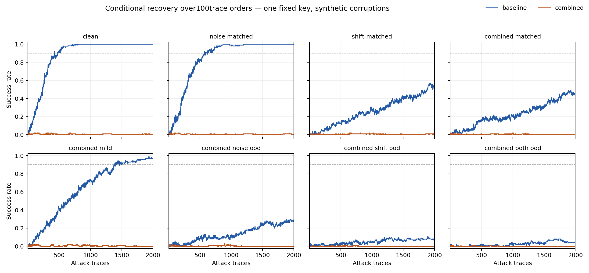

# When Trace Augmentation Fails

**A Controlled Study of Masked AES on ASCAD**  
Nikolaos Mavros · Hardware Security × Neural Networks

[IEEE paper (PDF)](report/paper.pdf) · [Six-slide presentation (PowerPoint)](report/presentation.pptx) · [Final experiment record](outputs/paper_confirmation_2026-10-11/REPORT_EL.md)

## Abstract

Synthetic noise and time shifts can expose a model to more varied traces during
training. On masked AES, those changes may also obscure relationships between
parts of a trace. We studied this trade-off on the public ASCAD benchmark.
Four convolutional neural networks (CNNs) trained on 10,000 profiling traces
failed the clean validation criterion. An expanded baseline passed, and we
compared it with a matched 45,000-trace run that used combined augmentation.
At 2,000 held-out traces, the unaugmented CNN recovered one target byte in
100/100 clean orders. The augmented CNN recovered it in 0/100 orders in every
test condition. Separate CPU diagnostics detected second-order leakage and
showed that a feature could retain signal on fresh profiling data while its
selection procedure remained unstable. The results apply to a specific
augmentation recipe, training seed, and acquisition campaign.

## 1. Introduction and related work

A trace records measurements from the physical implementation of a
cryptographic algorithm. When an implementation uses masking, useful
dependence may appear in the joint behavior of multiple samples. Our question
was whether a compact CNN trained with noise and shifts could improve recovery
under corruption while preserving recovery on clean traces.

ASCAD provides a public benchmark for studying masked AES. Previous studies
proposed compact profiling CNNs and tested augmentation for timing variation
and noise. The project adapts a literature-inspired CNN and uses a matched
comparison to measure the outcome of one combined augmentation recipe. The
CPU diagnostics test a complementary question about how reliably features
retain signal when they are selected again. [Selected references](#7-selected-references)

## 2. Experimental design

The fixed-key ASCAD campaign contains 50,000 profiling traces and a separate
10,000-trace test pool, with 700 samples per trace. The initial experiments
trained on 10,000 traces and validated on 5,000. The expanded baseline used
45,000 training traces and retained the original validation pool. The expansion
changed the number of distinct traces, optimization updates, and fitted scaler
together. [Expanded baseline report](outputs/kaggle_budget_2026-10-11/api/REPORT_EL.md)

The final pair used the same model, training rows, scaler, initialization seed,
and update count. One model added combined noise and shifts during training.
Both checkpoints were selected by clean validation loss and frozen before
accessing the test pool. The held-out comparison used eight prespecified
conditions, with common trace inputs and orders for the two models.
[Experiment protocol](docs/EXPERIMENT_PROTOCOL.md) · [Frozen comparison](docs/PAPER_CONFIRMATION_PROTOCOL_2026-10-11.md)

**Success rate (SR)** is the fraction of orders in which the correct byte ranked
first at a given trace budget. **Guessing entropy (GE)** is the mean zero-based
rank across those orders. Lower GE indicates a better rank. The clean baseline
criterion required at least 90% SR. The joint augmentation criterion required
at least 90% SR under stronger joint corruption, a positive paired gain over
the baseline under that condition, and at least 90% clean SR.

## 3. Results

### Clean validation

All four small-budget configurations recorded 0/20 successes at 2,000 traces.
The expanded baseline reached 20/20 on the same validation pool and the matched
augmented model reached 1/20. The small-to-expanded comparison leaves the
individual effects of more data, more updates, and scaler refitting unresolved.
[ReLU](outputs/kaggle_baseline_v3_2026-10-03/REPORT_EL.md) ·
[LeakyReLU](outputs/kaggle_leaky_v5_2026-10-03/REPORT_EL.md) ·
[Literature-inspired CNN](outputs/kaggle_literature_v7_2026-10-03/REPORT_EL.md) ·
[Revised schedule](outputs/kaggle_recipe_2026-10-09/REPORT_EL.md)

### Held-out fixed-key evaluation

Each row summarizes 100 overlapping evaluation orders at 2,000 traces.

| Condition | Baseline successes | Augmented successes | Baseline GE | Augmented GE |
| --- | ---: | ---: | ---: | ---: |
| Clean | 100/100 | 0/100 | 0.00 | 92.42 |
| Matched noise | 100/100 | 0/100 | 0.00 | 86.99 |
| Matched shifts | 54/100 | 0/100 | 4.77 | 99.44 |
| Matched noise and shifts | 44/100 | 0/100 | 5.17 | 102.98 |
| Mild noise and shifts | 97/100 | 0/100 | 0.05 | 92.14 |
| Higher noise | 27/100 | 0/100 | 10.19 | 101.06 |
| Higher shifts | 8/100 | 0/100 | 36.93 | 116.65 |
| Higher noise and shifts | 4/100 | 0/100 | 51.62 | 112.87 |

The baseline passed clean confirmation and maintained at least 90% SR from
479 traces through the budget. The augmented model failed all three parts of
the joint criterion. Under stronger joint corruption, its paired SR change was
−4 percentage points. [Final report](outputs/paper_confirmation_2026-10-11/REPORT_EL.md)

*Figure 1. Success across the tested trace budgets. The dashed line marks 90%
SR. Each panel uses orders from the same fixed-key acquisition.*

### CPU diagnostics

| Question | Observed outcome |
| --- | --- |
| Did useful leakage remain after the small CNNs failed? | Profiling diagnostics detected second-order signal on fixed-key traces. [Masking analysis](outputs/masking_diagnosis_2026-10-03/REPORT_EL.md) |
| Did alignment help under controlled corruption? | Gaussian and sum-of-absolute-differences alignment each reached 20/20 for both feature pairs under moderate corruption. Fixed positions and mismatched offsets reached 0/20. Under stronger corruption, the best point-based control reached 6/20. [Alignment controls](outputs/paper_alignment_controls_2026-10-05/REPORT_EL.md) |
| Did frozen features and reselection behave the same way? | Some features retained signal in fresh pools. When the second family was reselected using the window objective, median correlations were 0.0076 and 0.0066, below the 0.05 floor. [Resampling](outputs/paper_selection_stability_2026-10-06/REPORT_EL.md) · [Point versus window](outputs/paper_window_selection_2026-10-09/REPORT_EL.md) |
| Did the result extend to a variable-key campaign? | The prespecified recovery criterion failed, and the campaign differed in acquisition and noise scale. [Variable-key evaluation](outputs/paper_variable_campaign_2026-10-05/REPORT_EL.md) |

## 4. Discussion and limitations

The matched pair documents a failed augmentation recipe under a checkpoint
rule chosen in advance. The CPU evidence shows that detectable leakage,
stable feature selection, and held-out recovery can diverge. The mechanism
behind the neural failure remains open.

The 100 orders reuse traces from one campaign with one fixed key. The
comparison uses one training seed and applies synthetic perturbations to
measured traces. The design leaves between-seed and cross-device variation,
independent acquisition, and the separate training effects of noise and shifts
unresolved. The [study synthesis](outputs/study_synthesis_2026-10-05/REPORT_EL.md)
and [prior-art review](literature/CONTINUATION_AUDIT_2026-10-11.md) retain the
negative results and remaining evidence gaps.

## 5. Reproducibility

The project retained configurations, split identities, checkpoint histories,
and evidence for all six GPU trainings. The archived verification records
document 112 passing CPU tests and an independent replay of 3.2 million saved
rank prefixes. An earlier clean CPU environment reproduced the archived metrics
and sensitivity arrays. [CPU reproduction](docs/CPU_REPRODUCTION.md) ·
[Hash-pinned dependencies](requirements-lock-cpu-reproduction.txt) ·
[Final verification](outputs/paper_confirmation_2026-10-11/attack_verification.json)

| Location | Contents |
| --- | --- |
| [`src/sca/`](src/sca/) and [`configs/`](configs/) | Python/PyTorch package and experiment settings |
| [`tests/`](tests/) and [`notebooks/`](notebooks/) | Implementation checks, experiment records, and verification code |
| [`outputs/`](outputs/) and [`docs/`](docs/) | Archived results, protocols, and the [earlier working draft](docs/PAPER_DRAFT_2026-10-11.md) |
| [`literature/`](literature/) | Prior-art bibliography and audits |

The package targets Python 3.11 or newer. The local paper sources are
`report/main.tex`, `report/references.bib`, `report/graphs/`, and
`report/tables/`. With LaTeX, IEEEtran, and BibTeX installed, build from
`report/` with `latexmk -pdf -jobname=paper main.tex`.

## 6. Conclusion

The 45,000-trace baseline recovered the target byte consistently in the clean
held-out evaluation. Combined synthetic noise and time shifts failed to improve
recovery under the tested corruption and eliminated clean successes at the
endpoint. The diagnostic studies explain why a benchmark needs separate
evidence for leakage, selection stability, and held-out recovery.

## 7. Selected references

1. R. Benadjila et al., “Deep learning for side-channel analysis and introduction to ASCAD database,” 2020. [DOI](https://doi.org/10.1007/s13389-019-00220-8)
2. G. Zaid et al., “Methodology for efficient CNN architectures in profiling attacks,” 2020. [DOI](https://doi.org/10.46586/tches.v2020.i1.1-36)
3. L. Wouters et al., “Revisiting a methodology for efficient CNN architectures in profiling attacks,” 2020. [DOI](https://doi.org/10.46586/tches.v2020.i3.147-168)
4. E. Cagli, C. Dumas, and E. Prouff, “Convolutional neural networks with data augmentation against jitter-based countermeasures,” 2017. [DOI](https://doi.org/10.1007/978-3-319-66787-4_3)
5. H. Li and G. Perin, “A systematic study of data augmentation for protected AES implementations,” 2024. [DOI](https://doi.org/10.1007/s13389-024-00363-3)
6. G. Perin, L. Wu, and S. Picek, “Exploring feature selection scenarios for deep learning-based side-channel analysis,” 2022. [DOI](https://doi.org/10.46586/tches.v2022.i4.828-861)
