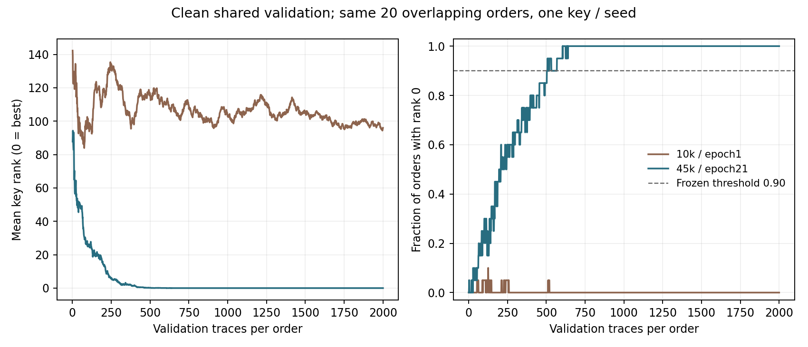
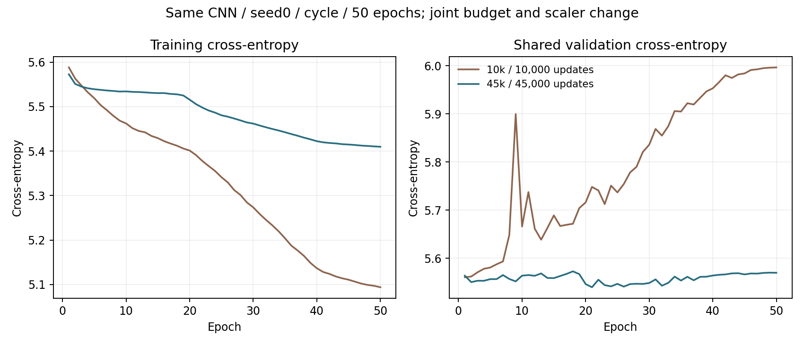

# Kaggle baseline45k — 11/10/2026

**Το προκαθορισμένο primary criterion ΠΕΡΑΣΕ.**

Η μία πρόσθετη baseline εκτελέστηκε στην version2 του private notebook nmavros/hw-sec-exp2, μετά από ρητή συμφωνία για45k/cap5 και account migration. Το original con1los notebook και όλα τα τέσσερα προηγούμενα trainings διατηρούνται.

Η version1 σταμάτησε πριν από training λόγω CRLF/LF στη συσκευασία, με μηδέν optimizer updates. Η version2 εγκρίθηκε χωριστά από τον χρήστη και μετέφερε ακριβώς τα ίδια frozen bytes. Η τεχνική αποτυχία και το αρχικό archive διατηρούνται. Δεν έγινε αυτόματη επανάληψη.

Ίδιο CNN16952, identity labels/byte2, seed0,50epochs,batch50 και authorlinearcycle max0,005. Training10k→45k, ίδιο χωριστό validation5k, refittedtrain-onlyMinMax. Updates10000→45000, exposures500000→2250000. Ελέγχεται η κοινή αλλαγή unique sample/update count/scaler fit, χωρίς isolated-cause ή equal-compute claim.

Minimum validation CE επιλέγει checkpoint. Όλα20orders/seed8001 διατηρούνται, budget2000, rank0best/conservative ties. Το validation είναι ήδη viewed και δεν αποτελεί ανεξάρτητη επιβεβαίωση efficacy. Original failed gates διατηρούνται.

| Run | Training | Updates | Best epoch | Minimum CE | SR@2000 | GE@2000 |
|---|---:|---:|---:|---:|---:|---:|
| recipe10k | 10000 | 10000 | 1 | 5.560471 | 0/20 | 96.000000 |
| budget45k | 45000 | 45000 | 21 | 5.539754 | 20/20 | 0.000000 |

Το45k setup έφτασε το παγωμένο diagnostic threshold. Αυτό δεν απομονώνει μοναδική αιτία και δεν αποδεικνύει independent-key efficacy. Combined απαιτεί νέα συγκεκριμένη πρόταση και συμφωνία· δεν εκτελέστηκε.

Δευτερεύον endpoint: SR ≥ 90% διατηρείται από τα 504 μέχρι τα 2.000 traces. Πρόκειται για τις ίδιες 20 επικαλυπτόμενες σειρές από ένα pool 5.000 traces, με ένα κλειδί και έναν training seed.

Ο ανεξάρτητος verifier έλεγξε45000LRvalues,40000rankprefixes,minimumCEselection, nested/disjointsplits, νέο train-onlyMinMaxfit και5000CPU/GPUprobabilities. Maxlogproberror7.49452365e-06, verifier12.004843s. Τα104CPUtests είχαν περάσει πριν το freeze και105 μετά τη διόρθωση μεταφοράς. Syntheticchecks μόνο ορθότητας.

Trainingloops156.097364s,validationloops6.375075s, experiment180.865040s μετά το notebook setup. Δεν μετράται εδώ συνολικό setup/queue/session ή account GPU κόστος. Exact recorded runtime equality με recipe10k: True. Το actual runtime καταγράφεται στο evidence.json.

Σύνολο5fullGPUtrainings/cap5exhausted. No combined/attack, originalfixedattacklocked, variableattackviewed unchanged και variableprofiling30kunused. Δεν επιλέγεται νέο μοντέλο/seed/checkpoint από attack ή ανεξάρτητο efficacy claim.

Μετά τη λήψη και την επαλήθευση, η version3 QUICK_SAVE επαναφέρει την αρχική notebook πηγή χωρίς εκτέλεση. Τα αποτελέσματα της version2 διατηρούνται χωριστά.

[Kaggle notebook](https://www.kaggle.com/code/nmavros/hw-sec-exp2) · [Frozen API plan](plan.json) · [Verification](verification.json) · [Evidence](evidence.json) · [Results](results.json)
