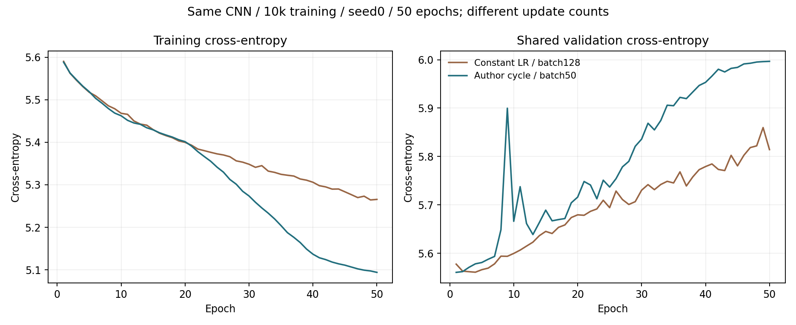

# Kaggle: ίδιο CNN με διαφορετικό training recipe — 9/10/2026

**Το προκαθορισμένο primary criterion ΑΠΕΤΥΧΕ.**

Ο χρήστης επέτρεψε ένα νέο πείραμα στο Kaggle. Η version 9 του ίδιου ιδιωτικού notebook εκτέλεσε μία επιπλέον baseline, με το ίδιο CNN των 16.952 parameters, original training 10k/validation 5k, seed 0, 50 epochs και train-only MinMax. Δεν έγινε combined training και δεν διαβάστηκε attack payload.

Η υπόθεση ήταν ότι το προσαρμοσμένο author optimizer recipe αποκαθιστά clean validation SR@2000 ≥ 18/20. Άλλαξαν batch 128 → 50 και constant Adam LR 0,001 → τριφασικό γραμμικό cycle με max 0,005. Ο αριθμός updates αυξήθηκε από 3.950 σε 10.000, με ίδιες 500.000 εκθέσεις traces. Ελέγχεται το joint recipe, χωρίς equal-update ή isolated-cause claim.

Το [πρωτόκολλο και author-code audit](LITERATURE_AND_PROTOCOL.md) και το [plan](plan.json) πάγωσαν πριν από τη νέα εκπαίδευση. Η LR επέκταση έχει δικό της hash σε plan/config/checkpoints· ο production source παρέμεινε αμετάβλητος. Η προσαρμογή δεν αναπαράγει το πλήρες author 45k/Keras experiment.

## Κοινό validation endpoint

Checkpoint επιλογής: minimum validation CE μεταξύ των 50 epochs. Αξιολόγηση: όλα τα ίδια 20 trace orders, budget 2.000 και rank 0 = best, με conservative ties. Το validation έχει ήδη εξεταστεί. Δεν αποτελεί νέα prospective confirmation ή ανεξάρτητο acquisition/key.

| Recipe | Updates | Best epoch | Minimum CE | SR@2000 | GE@2000 |
|---|---:|---:|---:|---:|---:|
| constant LR / batch128 | 3950 | 4 | 5.560782 | 0/20 | 114.250000 |
| author linear cycle / batch50 | 10000 | 1 | 5.560471 | 0/20 | 96.000000 |

Το joint recipe δεν αποκατέστησε το απαιτούμενο clean recovery στο κοινό validation. Η συγκεκριμένη αλλαγή δεν αρκεί υπό το 10k/50-epoch setup. Δεν αποδεικνύεται ότι μεγαλύτερο unique training budget ή άλλος model θα αποτύγχανε, ούτε απομονώνεται μοναδική αιτία των CNN failures.

Στην τελευταία epoch το νέο training CE είναι 5.093989 και το validation CE 5.996656, έναντι 5.265615 και 5.814250 στο παλιό recipe. Η καλύτερη προσαρμογή στο training συνυπάρχει με χειρότερο τελικό validation CE. Πρόκειται για περιγραφική απόκλιση, χωρίς απομόνωση αιτίας της αποτυχίας recovery.

## Επαλήθευση, κόστος και όρια

Πριν το freeze πέρασαν 99 tests/14 προϋπάρχουσες warnings, με JUnit χρόνο 17.322s. Τα τέσσερα νέα tests περιλαμβάνουν πραγματικό synthetic CPU smoke και state-continuation check. Αποτελούν correctness checks, χωρίς φυσική efficacy evidence.

Ο χωριστός verifier έλεγξε 10.000 LR values, minimum-CE checkpoint, ίδια splits και normalizer, όλες τις 40.000 GPU rank prefixes και CPU inference σε 5.000 traces. Μέγιστη CPU/GPU log-probability απόκλιση: 1.14903992e-06. Επαληθεύτηκαν τα hashes όλων των προηγούμενων checkpoints και εισόδων.

Τα αποθηκευμένα περιβάλλοντα συμφωνούν: Python 3.13.15, Torch 2.8.0+cu126, CUDA 12.6, Tesla T4, NumPy 2.2.6 και h5py 3.14.0. Η version 10 είναι QUICK_SAVE της αρχικής ασφαλούς notebook πηγής, χωρίς νέα εκτέλεση. Η executed version 9, τα νέα checkpoints και οι προβλέψεις διατηρούνται.

Training loops 48.935854s, validation loops 7.492933s. Experiment wall time 70.122321s· τοπικός verifier 8.430090s χωριστά. Τα loops δεν περιλαμβάνουν setup, installs, queue ή session teardown. Το experiment timer αρχίζει μετά το notebook setup και περιλαμβάνει checks/training/checkpoint I/O/evaluation. Δεν καταγράφεται ολόκληρη η GPU χρέωση του λογαριασμού ως μετρημένο κόστος.

Το όριο είναι πλέον τέσσερα ολοκληρωμένα GPU trainings συνολικά. Η παρούσα εκτέλεση δεν ενεργοποιεί automatic combined ή νέο seed/budget. Το αρχικό αποτυχημένο gate και όλες οι CPU αρνητικές επιβεβαιώσεις διατηρούνται. Οι 30.000 unused variable profiling rows παραμένουν αχρησιμοποίητες. Το αρχικό fixed attack παραμένει locked και το viewed variable attack δεν επαναξιολογήθηκε.

Η ισχυρότερη ερμηνεία παραμένει diagnostic benchmark/failure analysis. Δεν τεκμηριώνεται νέα μέθοδος, cross-device physical efficacy ή ανεξάρτητη key-recovery γενίκευση.

[Kaggle notebook — executed version 9](https://www.kaggle.com/code/con1los/hw-sec-exp2) · [Results](results.json) · [Evidence](evidence.json) · [Independent verification](verification.json) · [Execution status](execution_status.json) · [Tests](pytest.xml)
