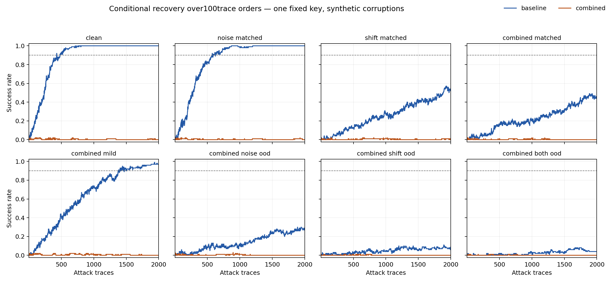
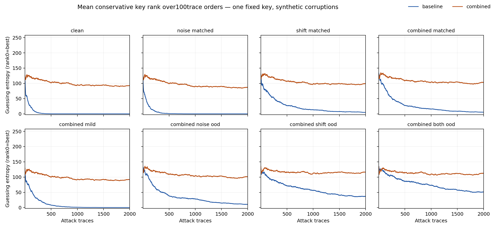

# Combined45k και κλειδωμένη τελική attack αξιολόγηση — 11/10/2026

**H1 baseline clean confirmation: ΠΕΡΑΣΕ. H2 augmentation joint primary: ΑΠΕΤΥΧΕ.**
Όλες οι οκτώ προκαθορισμένες συνθήκες και όλες οι100σειρές διατηρούνται.
Δεν επιλέχθηκε νέο checkpoint ή recipe από τα attack αποτελέσματα.

## Κλειδωμένο πείραμα

Επαναχρησιμοποιήθηκε η verified baseline45k, minimumCE checkpoint epoch21.
Μία combined45k εκπαίδευση στο ίδιο private nmavros/hw-sec-exp2/version4:
CNN16952,seed0,45k/5k,50epochs,batch50,45000author-cycleupdates/2250000exposures.
Ίδια splits και training-only featureMinMax. Μόνη recipe αλλαγή shifts±5/zero
padding, κατόπιν Gaussianσ0,1, μετάMinMax χωρίς clipping. Minimum clean validation
CE επέλεξε το combined checkpoint epoch4, CE5.549329338.
Clean viewed validation combinedSR@2000=0.05,
GE107.200000. Το validation δεν είναι νέα confirmation.

Μετά ανεξάρτητη επαλήθευση45000LRvalues/40000rankprefixes/5000CPUpredictions,
κλειδώθηκαν και τα δύο checkpoints. Τότε άνοιξε το πλήρες originalfixedattack10k
για μία CPU paired αξιολόγηση, budget2000/100orders/seed8001, corruptionseed9001,
ίδιες αλλοιωμένες inputs και orders στα δύο μοντέλα. Byte2/identity256, traces-only
model inputs, evaluation metadata/key μόνο για scoring, conservative ties/rank0best.

## Όλα τα αποτελέσματα attack

|Condition|Baseline SR@2000|Combined SR@2000|Baseline GE|Combined GE|Baseline sustainedSR90|Combined sustainedSR90|
|---|---:|---:|---:|---:|---|---|
|clean|100/100|0/100|0.000000|92.420000|479|>2000 (censored)|
|noise_matched|100/100|0/100|0.000000|86.990000|625|>2000 (censored)|
|shift_matched|54/100|0/100|4.770000|99.440000|>2000 (censored)|>2000 (censored)|
|combined_matched|44/100|0/100|5.170000|102.980000|>2000 (censored)|>2000 (censored)|
|combined_mild|97/100|0/100|0.050000|92.140000|1470|>2000 (censored)|
|combined_noise_ood|27/100|0/100|10.190000|101.060000|>2000 (censored)|>2000 (censored)|
|combined_shift_ood|8/100|0/100|36.930000|116.650000|>2000 (censored)|>2000 (censored)|
|combined_both_ood|4/100|0/100|51.620000|112.870000|>2000 (censored)|>2000 (censored)|

H1 απαιτεί baselinecleanSR≥0,90. H2 απαιτεί ταυτόχρονα combined_both_oodSR≥0,90,
strictlypositivepairedΔSR έναντι baseline και combinedcleanSR≥0,90. Δεν αλλάζει
το primary εκ των υστέρων. Άλλα contrasts/GE/sustainedSR είναι descriptive secondary.

|Condition|Paired ΔSR|Both success|Baseline only|Combined only|Neither|
|---|---:|---:|---:|---:|---:|
|clean|-1.00|0|100|0|0|
|noise_matched|-1.00|0|100|0|0|
|shift_matched|-0.54|0|54|0|46|
|combined_matched|-0.44|0|44|0|56|
|combined_mild|-0.97|0|97|0|3|
|combined_noise_ood|-0.27|0|27|0|73|
|combined_shift_ood|-0.08|0|8|0|92|
|combined_both_ood|-0.04|0|4|0|96|

## Όρια ερμηνείας

Η attack confirmation αφορά αθέατες traces της ίδιας fixed-key καμπάνιας,
ίδιο key/acquisition context. Δεν είναι νέο κλειδί, συσκευή ή ανεξάρτητη φυσική
καμπάνια. Οι100overlapping trace orders είναι conditional, όχι100independent
trainings/keys/acquisitions. Δεν αποδίδονται independentBernoulliCIs/p-values.
Τα noise/shifts είναι συνθετικές αλλοιώσεις πραγματικών traces. Ένας trainingseed
δεν εκτιμά between-training variance. Καμία νέα efficacy ή novelty claim πέρα από
τις συγκεκριμένες μετρήσεις δεν ακολουθεί. Τα τέσσερα10kfailures και οι CPU/variable
campaign/selection failures διατηρούνται. Η baseline10k→45k άλλαξε από κοινού
samples/updates/scaler· η νέα matched σύγκριση αφορά μόνο την combined recipe.

## Επαλήθευση, πραγματικό κόστος και ιστορικό

Ο ανεξάρτητος attack verifier ανακατασκεύασε3200000rankprefixes,
GE/SR/sustainedSR/paired endpoints από savedpredictions, ίδιοplaintext/key/orders,
finite normalizedprobabilities και τα δύο primarycriteria. Δεν έγινε optimizerupdate
στην attack αξιολόγηση. Training verifier9.882743s,
CPUattack evaluation32.868586s,
attack replay verifier21.687648s.
Combinedtrainingloops181.405335s,
validationloops6.612318s,
experiment204.848679s μετάsetup. Setup/queue/accountGPUcharge
δεν μετρήθηκαν ως συνολική χρέωση. Recordedruntime matchesbaseline:
True.

Αρχική SaveKernel υποβολή:HTTP400 πριν από version/training, preservedreceipt.
Χωριστά approved compactTAR/XZ correctedsubmission:version4, exactfrozenbytes,
scienceunchanged. Η ακριβής αρχική servercause παραμένει unconfirmed.
112CPUtests passed/14existingwarnings. Τα40previouspreservationartifacts πέρασαν.
Μετά ολοκλήρωση, version5 QUICK_SAVE originalsource χωρίςrun,
remote cells/private/Input verified. Originalcon1los history και nmavrosversions1–4
διατηρούνται. Actual6fullGPUtrainings/cap6exhausted,111850totalupdates/6500000exposures.
Variableprofiling30k unused/variableattack10k unchanged. Νέο πείραμα/seed/model/budget
ή retuning σε αυτά τα viewed attack rows δεν εξουσιοδοτείται από αυτό το πρωτόκολλο.

Πρωτόκολλο:[frozen proposal](../../docs/PAPER_CONFIRMATION_PROTOCOL_2026-10-11.md),
[machine plan](plan.json),[specific approval](authorization.json),
[training verification](training_verification.json),[attack verification](attack_verification.json).
