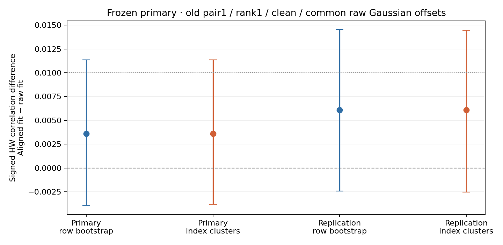
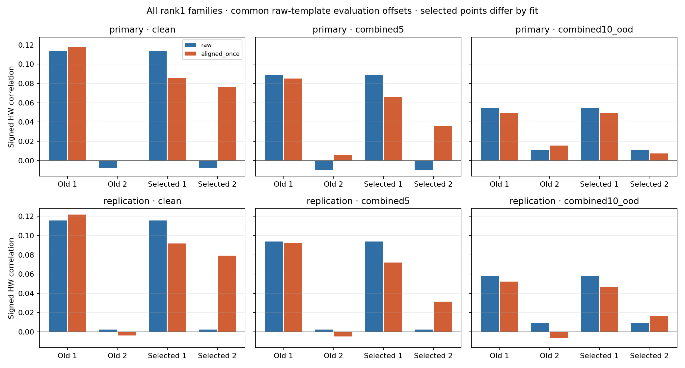

# Training-side ευθυγράμμιση — prospective CPU phase9, 6/10/2026

Το παγωμένο primary criterion δεν πέρασε. Δημοσιεύονται και οι432 συγκρίσεις· κανένα νέο attack payload ή Kaggle training.

## Τι ελέγχθηκε

Η επίσημη variable-key καμπάνια έχει native desynchronization. Τα προηγούμενα feature fits γίνονταν σε unaligned training. Η νέα φάση ελέγχει ένα συγκεκριμένο consistency hypothesis, όχι αιτιώδη απόδειξη ότι το jitter εξηγεί παλιότερες αποτυχίες.
Ίδιο αρχικό training10k. Μία trace-only Gaussian alignment pass με raw unconditional mean/diagonal variance, inclusive±10, tie(absδ,δ), scoring columns20:1380. Άμεση μετατόπιση των original rows κατά−δ, χωρίς επαναληπτικό shifting ή labels στα offsets.
Raw και aligned-once fits έχουν δικά τους training centers και point/box/leading-covariance-rank1 weights. Orientation και επιλογή points από HW των provided training identity labels μόνο. Κανένα mask/key/plaintext/metadata fit input.
Τα δύο παλιά pairs διατηρούνται και στα δύο fits. Κάθε fit επιλέγει επίσης δύο pairs, πλήρες |Pearson(centered product,HW)| search, separation50/diversity20, κοινόmargin25.845.650 eligible candidates ανά stage. Margin25 προστατεύει τα11-sample windows και από training padding και από maximum injected shift10 συν candidate offset10.
Νέα δύο profiling20k pools, seeds20261016/17, όλα τα70k ήδη viewed rows excluded. Κάθε fit αποθηκεύτηκε πριν το πρώτο confirmation read. Τα40k νέα rows είναι τώρα viewed evidence· future unseen confirmation πρέπει να τα αποκλείει.
432 rows=2pools×3conditions×3evaluationalignments×2fits×4pairfamilies×3features. Raw-selected pairs συμπίπτουν εδώ με τα παλιά pairs: κάποιες rows είναι αριθμητικά ίδιες. Ο αριθμός rows δεν μετρά ανεξάρτητα experiments, keys ή devices.
Primary: aligned-once−raw signed HW correlation, old_pair1/covariance_rank1/clean, με ακριβώς ίδια gaussian_raw evaluation offsets. Έτσι ελέγχεται αλλαγή feature fitting (center και weights), ενώ ο evaluation alignment κανόνας παραμένει σταθερός. Δr≥0,01 και lower>0 και στα δύο pools και στα δύο bootstrap schemes.
Refined Gaussian template, νέα points, fixed/no-alignment καιcombined5/OOD αποτελούν προκαθορισμένα secondary controls. Δεν αντικαθιστούν το primary ούτε επιλέγουν επόμενο μοντέλο από viewed attack data.

## Παγωμένο primary και uncertainty

9.999 paired-row και9.999 index-cluster draws ανά pool, 200HDF5 bins των1.000 indices. Nominal99,75% two-sided percentile intervals (α0,01/family4). Index bins δεν έχουν επαληθευτεί ως acquisition-time blocks· iid-row/cluster assumptions είναι προσεγγιστικές. Conditional στη fitted direction/realized data και χωρίς συνολικό across-phase alpha-spending για adaptive research.

| Pool / scheme | Δr | Lower | Upper | Criterion |
|---|---:|---:|---:|---|
| primary / paired_rows | 0.003601 | -0.003958 | 0.011358 | Δεν πέρασε |
| primary / index_clusters | 0.003601 | -0.003822 | 0.011348 | Δεν πέρασε |
| replication / paired_rows | 0.006085 | -0.002443 | 0.014538 | Δεν πέρασε |
| replication / index_clusters | 0.006085 | -0.002520 | 0.014471 | Δεν πέρασε |

## Training-only points και πλήρεις controls

| Fit | Old1 | Old2 | Selected1 | Selected2 |
|---|---|---|---|---|
| raw | 187×1080 | 334×573 | 187×1080 | 334×573 |
| aligned_once | 187×1080 | 334×573 | 76×1070 | 199×1013 |

Gaussian raw-template evaluation, rank1 signed correlations. Κάθε κελί δείχνει raw fit / aligned fit:

| Pool / condition | Old1 | Old2 | Selected1 | Selected2 |
|---|---:|---:|---:|---:|
| primary / clean | 0.113760 / 0.117362 | -0.007854 / -0.000910 | 0.113760 / 0.085521 | -0.007854 / 0.076546 |
| primary / combined5 | 0.088650 / 0.084980 | -0.009763 / 0.005721 | 0.088650 / 0.066077 | -0.009763 / 0.035757 |
| primary / combined10_ood | 0.054315 / 0.049704 | 0.010600 / 0.015456 | 0.054315 / 0.049346 | 0.010600 / 0.007339 |
| replication / clean | 0.115552 / 0.121637 | 0.002304 / -0.003622 | 0.115552 / 0.091854 | 0.002304 / 0.079067 |
| replication / combined5 | 0.093910 / 0.092111 | 0.002341 / -0.004804 | 0.093910 / 0.071915 | 0.002341 / 0.031564 |
| replication / combined10_ood | 0.057967 / 0.052387 | 0.009449 / -0.006422 | 0.057967 / 0.046820 | 0.009449 / 0.016815 |

Τα selected-family comparisons αλλάζουν points και feature fit μαζί, άρα δεν απομονώνουν alignment effect στην ίδια περιοχή. Signed directions ήταν frozen από training: αρνητική confirmation correlation διατηρείται, δεν αναστρέφεται εκ των υστέρων.
Αυτά είναι correlation endpoints με γνωστές profiling labels, όχι constant-key recovery ή νέα πραγματικά attack results. Δεν αποδεικνύουν reliable variable-key attack στοbudget2.000. Παραμένουν τα phase7 attack3/20–4/20, το failed18/20 criterion και τα προηγούμενα primary failures.

## Επαλήθευση, κόστος και paper claim

86tests passed/14existingwarnings σε15,43s (JUnit15.396s). CPU experiment232.517110s, independent verifier99.027519s. Fit κόστος13.345393s περιλαμβάνεται στο experiment.
Verifier: όλα10.000training offsets,2full selection matrices,64direct individual-product coefficients,24weight vectors καιtraining correlations.432confirmation correlations/all products,39.996bootstrap draws,6actual-row cluster replay checks,528sampled evaluation offsets, splits/RNG/timestamps/hash preservation και feature-padding bounds.
Εννέα φάσεις experimental CPU wall time2374.714738s· verifier/test/report χρόνοι καταγράφονται χωριστά. Recovery summaries988/execution checks19.760/additional endpoint replays10.960 παραμένουν ίδια. Αυτή η φάση δεν κάνει CPA recovery.
Fixed profiling50kused· variableprofiling110kused/90kunused· variableattack10kviewed, originalfixedattacklocked. Παραμένουν1.ipynb/3GPUtrainings/failedCNNgate/source/checkpoints, μηδέν optimizerupdates στη νέα φάση.
Training-side alignment, window averaging καιSVD έχουν prior art. Η συγκριτική εμπειρική μελέτη δεν τεκμηριώνει νέα επίθεση ή publication-ready novelty. Χρειάζεται πλήρης σύγκριση με prior methods και independent acquisition/key evidence για efficacy claim.

[Plan](plan.json) · [Splits](splits.npz) · [Training access](training_access.json) · [Confirmation access](evaluation_access.json) · [Fit](fit.json) · [Fit arrays](fit.npz)
[Results](results.json) · [All arrays](arrays.npz) · [All432 CSV rows](correlations.csv) · [Tests](pytest.xml) · [Verification](verification.json) · [Evidence](evidence.json)
[Execution code](../../notebooks/paper_training_alignment.py) · [Independent verifier](../../notebooks/verify_training_alignment.py) · [Primary audit](../../literature/TRAINING_ALIGNMENT_2026-10-06.md)
