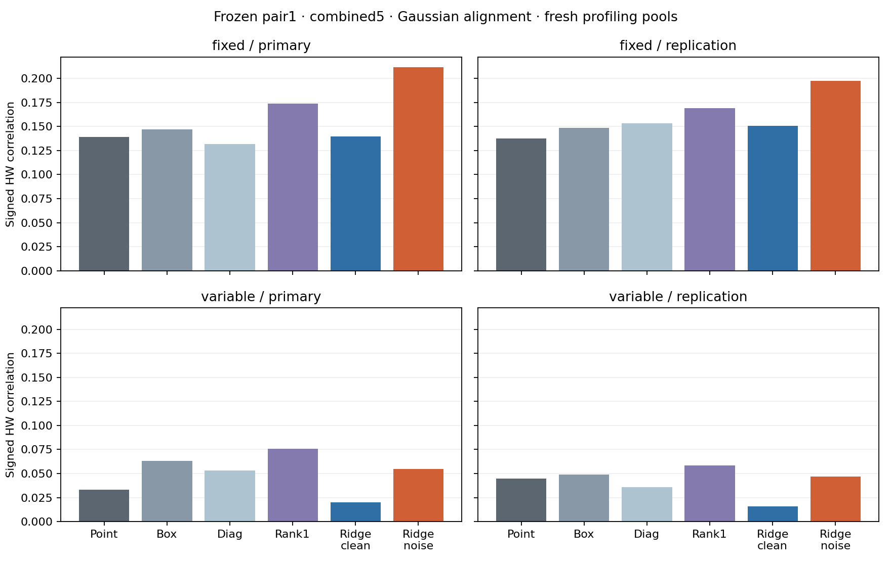
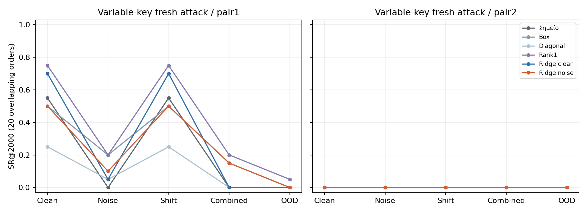

# Παράθυρα δεύτερης τάξης και αναλυτική noise-aware regression — 6/10/2026

Πραγματική CPU εκτέλεση:900 correlation comparisons και540 recovery summaries, 999.124509s.
Είναι factorial rows, όχι900 ανεξάρτητα πειράματα/κλειδιά. Όλα τα fits και thresholds πάγωσαν πριν τα νέα δεδομένα.
Το primary criterion δεν πέρασε· το προκαθορισμένο secondary attack criterion δεν πέρασε.
Paper readiness και novelty παραμένουν ανεπιβεβαίωτα. Δεν αρκεί να διαλέξουμε το καλύτερο row για publication claim.

## Πρωτόκολλο και πληροφορία

Αρχικό10k training ανά campaign, ίδιοι frozen point centers, radius5/11samples, ένα closed-form fit/μέθοδο· κανένα optimizer/GPU training.
Οι έξι μέθοδοι είναι point, product δύο box averages, average11 diagonal products, rank1 SVD της target covariance, ridge clean και ridge με analytic added-noise covariance.
Τα train labels μετατρέπονται σε HW. Δεν χρησιμοποιούνται masks/keys/plaintext για επιλογή points/weights ή alignment. Window variants βλέπουν22 samples έναντι2 του point· δεν έχουν ίση capacity ή label information με CNN.
Τα121 product features standardized από το training μόνο· ίδιο ridge0,01 και στις δύο ridge λύσεις. Η noise-aware λύση χρησιμοποιεί σraw1,3/fixed και4,8/variable, καθορισμένο από0,1×median training range.
Πέντε συνθήκες clean/noise5/shift5/combined5/OOD και fixed/Gaussian/SAD mean alignment. Same U/Z/orders μέσα στα pools. Noise-only και shift-only είναι CPU evaluations, όχι πρόσθετα neural trainings.
Δύο disjoint fresh profiling5k pools ανά campaign. Fresh variable attack5k αποκλείει τις προηγούμενες5k attack rows: νέο trace subset με το ίδιο ήδη εξετασμένο κλειδί/συσκευή/καμπάνια. Κανένα attack-based selection, όλα τα fits παγωμένα πριν οποιοδήποτε holdout.
Τα variable profiling keys ποικίλλουν: εκεί μετράμε correlation, χωρίς fabricated constant-key CPA. CPA μόνο στα πραγματικά constant-key fixed profiling και variable fresh attack pools. Το original fixed-key final attack παραμένει locked.

## Primary: noise-aware έναντι clean ridge

Pair1/combined5/Gaussian, signed correlation (orientation από training). Support απαιτεί και στα τέσσερα profiling pools Δr≥0,01 και lower bound>0.
1.999 paired row bootstraps ανά pool· two-sided percentile intervals98,75% (Bonferroni family4, tail0,00625). Είναι approximate conditional intervals υπό iid-row assumption, χωρίς exact coverage ή training/acquisition variability.

| Campaign / pool | Δr | Lower | Upper | Criterion |
|---|---:|---:|---:|---|
| fixed / primary | 0.072050 | 0.048726 | 0.096849 | Πέρασε |
| fixed / replication | 0.047055 | 0.022898 | 0.071398 | Πέρασε |
| variable / primary | 0.034367 | -0.004396 | 0.070606 | Δεν πέρασε |
| variable / replication | 0.030839 | -0.003704 | 0.065703 | Δεν πέρασε |

## Όλες οι μέθοδοι: primary profiling endpoint

| Campaign / pool | Σημείο | Box | Diagonal | Rank1 | Ridge clean | Ridge noise |
|---|---:|---:|---:|---:|---:|---:|
| fixed / primary | 0.138931 | 0.146702 | 0.131953 | 0.173952 | 0.139714 | 0.211764 |
| fixed / replication | 0.137505 | 0.148777 | 0.153047 | 0.169289 | 0.150519 | 0.197574 |
| variable / primary | 0.033033 | 0.063107 | 0.052956 | 0.075772 | 0.020295 | 0.054661 |
| variable / replication | 0.044688 | 0.048902 | 0.035636 | 0.058627 | 0.015771 | 0.046610 |

## Ανάκτηση πραγματικού byte: Gaussian alignment

Κάθε cell δίνει pair1/pair2 successes από20 κοινά, επικαλυπτόμενα trace orders, budget2.000. Rank0best, conservative ties1e−12. Οι20 orders δεν είναι20 ανεξάρτητα keys/training seeds.

### fixed / primary

| Feature | Clean | Noise5 | Shift5 | Combined5 | OOD |
|---|---|---|---|---|---|
| Σημείο | 20/20 / 20/20 | 20/20 / 20/20 | 20/20 / 20/20 | 20/20 / 20/20 | 10/20 / 3/20 |
| Box | 20/20 / 20/20 | 20/20 / 20/20 | 20/20 / 20/20 | 20/20 / 20/20 | 20/20 / 20/20 |
| Diagonal | 20/20 / 15/20 | 20/20 / 11/20 | 20/20 / 15/20 | 20/20 / 10/20 | 20/20 / 9/20 |
| Rank1 | 20/20 / 20/20 | 20/20 / 20/20 | 20/20 / 20/20 | 20/20 / 20/20 | 20/20 / 20/20 |
| Ridge clean | 20/20 / 20/20 | 20/20 / 20/20 | 20/20 / 20/20 | 20/20 / 20/20 | 8/20 / 2/20 |
| Ridge noise | 20/20 / 20/20 | 20/20 / 20/20 | 20/20 / 20/20 | 20/20 / 20/20 | 20/20 / 20/20 |

### fixed / replication

| Feature | Clean | Noise5 | Shift5 | Combined5 | OOD |
|---|---|---|---|---|---|
| Σημείο | 20/20 / 20/20 | 20/20 / 20/20 | 20/20 / 20/20 | 20/20 / 18/20 | 7/20 / 3/20 |
| Box | 20/20 / 20/20 | 20/20 / 20/20 | 20/20 / 20/20 | 20/20 / 20/20 | 20/20 / 20/20 |
| Diagonal | 20/20 / 20/20 | 20/20 / 20/20 | 20/20 / 20/20 | 20/20 / 20/20 | 20/20 / 16/20 |
| Rank1 | 20/20 / 20/20 | 20/20 / 20/20 | 20/20 / 20/20 | 20/20 / 20/20 | 20/20 / 20/20 |
| Ridge clean | 20/20 / 20/20 | 20/20 / 20/20 | 20/20 / 20/20 | 20/20 / 19/20 | 13/20 / 0/20 |
| Ridge noise | 20/20 / 20/20 | 20/20 / 20/20 | 20/20 / 20/20 | 20/20 / 20/20 | 20/20 / 20/20 |

### variable / fresh_attack

| Feature | Clean | Noise5 | Shift5 | Combined5 | OOD |
|---|---|---|---|---|---|
| Σημείο | 11/20 / 0/20 | 0/20 / 0/20 | 11/20 / 0/20 | 0/20 / 0/20 | 0/20 / 0/20 |
| Box | 10/20 / 0/20 | 4/20 / 0/20 | 10/20 / 0/20 | 3/20 / 0/20 | 0/20 / 0/20 |
| Diagonal | 5/20 / 0/20 | 1/20 / 0/20 | 5/20 / 0/20 | 0/20 / 0/20 | 0/20 / 0/20 |
| Rank1 | 15/20 / 0/20 | 4/20 / 0/20 | 15/20 / 0/20 | 4/20 / 0/20 | 1/20 / 0/20 |
| Ridge clean | 14/20 / 0/20 | 1/20 / 0/20 | 14/20 / 0/20 | 0/20 / 0/20 | 0/20 / 0/20 |
| Ridge noise | 10/20 / 0/20 | 2/20 / 0/20 | 10/20 / 0/20 | 3/20 / 0/20 | 0/20 / 0/20 |

Secondary criterion αφορά ridge_noise/Gaussian/pair1/combined5: SR3/20, point0/20, ridge clean0/20. Απαιτεί18/20 και τουλάχιστον2/20 βελτίωση από καθένα. Δεν επιλέγεται άλλη μέθοδος μετά την αξιολόγηση.

## Τι αποδεικνύει και τι μένει ανοικτό

Στο fixed-key OOD/Gaussian, box/rank1/ridge noise έδωσαν20/20 και στα δύο pairs, σε αμφότερα τα νέα pools. Point:10/20,3/20 και7/20,3/20· clean ridge:8/20,2/20 και13/20,0/20. Αυτό είναι σημαντικό secondary robustness εύρημα για γνωστά window baselines, όχι προαποφασισμένο primary success ή superiority της noise ridge από box/rank1.
Στο variable-key fresh attack/Gaussian/combined5, rank1 έδωσε4/20 στοpair1 έναντι noise ridge3/20 και clean ridge/point0/20. Κανένα δεν φτάνει18/20· pair2όλες0/20. Η νέα correction δεν είναι ο γενικός winner και δεν αποδεικνύεται zero leakage από failures.
Το analytic covariance increment N=σ²(C_A⊗I+I⊗C_B)+σ⁴I είναι exact conditional identity για disjoint windows και ανεξάρτητο zero-mean added noise. Δεν χρειάζεται Gaussian assumption για την identity. Οι9 νέες synthetic/unit checks ελέγχουν τον κώδικα, όχι φυσική efficacy.
Η identity δεν αφαιρεί native noise, colored noise, local elastic jitter ή masking. Alignment offsets επιλέγονται από noisy waveforms· η effective noise μετά την επιλογή τους δεν ακολουθεί την ίδια iid assumption. Το known-σ fit εξετάζει το συγκεκριμένο artificial stress, δεν υποθέτει estimator του άγνωστου physical σ.
Same relative noise factors σημαίνουν διαφορετικές raw amplitudes μεταξύ campaigns, όχι causal effect μόνο του key. Two row pools μοιράζονται training και acquisition campaign. Το variable attack key απουσιάζει από training full keys, αλλά είχε ήδη εξεταστεί στην παλιότερη φάση.
Averaging/window integration/SVD/regression/noise regularization έχουν prior art. Δεν έχει ολοκληρωθεί η full-text σύγκριση με orthogonal regression/scheme-aware modeling. Άρα ακόμη και θετικό endpoint δεν τεκμηριώνει novel attack ή έτοιμο paper.
Ένας υποψήφιος paper άξονας είναι το reproducible comparison της analytically noise-regularized quadratic extraction, μαζί με leakage cancellation, cross-campaign failure boundaries και prospective replications. Απαιτεί verified novelty, ισχυρότερα independently acquired/key datasets και επαρκή controls πριν υποβολή.

## Επαλήθευση, κόστος και αρχεία

79tests passed/14 existing warnings· JUnit17.698s. Independent replay111.562976s:24 weight vectors/all fit moments,900 correlation rows,10.800 επιπλέον endpoint replays,7.996 bootstrap draws,1.600 sampled alignment offsets και όλα τα splits/RNG.
Δεν έγινε independent full-prefix replay όλων των CPA curves· τα endpoints επανυπολογίστηκαν άμεσα και τα αποθηκευμένα ranks ελέγχθηκαν για GE/SR/sustained thresholds. Οι replays δεν είναι πρόσθετο physical evidence.
Επτά CPU φάσεις:1889.512755s καταγεγραμμένου experimental wall time (δεν περιλαμβάνει verifiers/tests/literature/report writing). Recovery summaries988, execution endpoint checks19.760, additional endpoint replays10.960. Αυτά είναι computational counts, όχι ανεξάρτητες φυσικές επαναλήψεις.
GPU νέα0, συνολικά3full trainings, ένα Kaggle notebook· failed gate/source/checkpoints/packets αμετάβλητα. Fixed profiling50k πλέον viewed/allocated, variable profiling30k, variable attack10k. Καμία viewed row δεν γίνεται future unseen confirmation.

[Frozen plan](plan.json) · [Splits](splits.npz) · [Fit](fit.json) · [Fit arrays](fit.npz) · [Access log](evaluation_access.json) · [Results](results.json) · [Arrays](arrays.npz)
[Correlation CSV](correlations.csv) · [Recovery CSV](recovery.csv) · [Alignment CSV](alignment.csv) · [Tests](pytest.xml) · [Verification](verification.json) · [Evidence](evidence.json)
[Κώδικας](../../notebooks/paper_window_regression.py) · [Independent verifier](../../notebooks/verify_window_regression.py) · [Βιβλιογραφία/παραγωγή identity](../../literature/WINDOW_REGRESSION_2026-10-06.md)
[Πρόσθετος primary έλεγχος και access gaps](../../literature/WINDOW_REGRESSION_PRIOR_ART_FOLLOWUP_2026-10-06.md)
