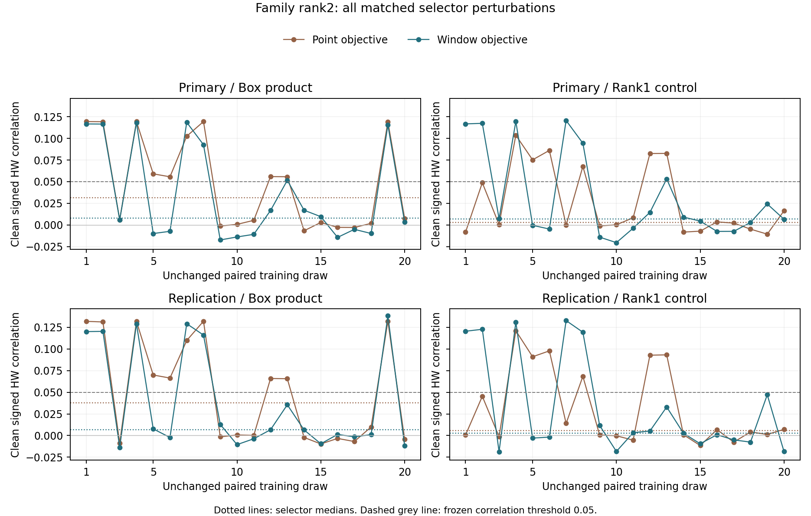

# Επιλογή σημείων και παραθύρων: ελεγχόμενη σύγκριση — 9/10/2026

**H1 primary: ΑΠΕΤΥΧΕ. H2 secondary: ΑΠΕΤΥΧΕ.**

Η φάση 11 ελέγχει αν η αστάθεια της επιλογής οφείλεται στη διαφορά μεταξύ του στόχου επιλογής και του τελικού χαρακτηριστικού. Η παλιά μέθοδος επιλέγει μεμονωμένα σημεία, ενώ η νέα επιλέγει απευθείας το γινόμενο των κεντραρισμένων μέσων δύο παραθύρων 11 δειγμάτων, μεγιστοποιώντας την απόλυτη συσχέτιση Pearson.

Η σύγκριση χρησιμοποιεί ακριβώς τα ίδια 20 ζευγαρωμένα training draws της φάσης 10 από τις αρχικές 10.000 traces. Διατηρούνται τα κέντρα ανά draw, η ευθυγράμμιση της φάσης 9, ακτίνα 5, περιθώριο 25, ελάχιστη απόσταση 50, κανόνας ποικιλίας 20 και τα ίδια 845.650 επιτρεπτά ζεύγη κέντρων. Αξιολογούνται όλα τα point/box/rank1 controls και οι δύο οικογένειες. Δεν επιλέγεται καλύτερο draw, ensemble ή νέα περιοχή/παράμετρος.

Οι υποθέσεις, τα κριτήρια, τα splits, το κόστος, ο κανόνας διακοπής και τα hashes κώδικα/εισόδων πάγωσαν πριν την πρόσβαση στα training δεδομένα. Όλα τα νέα fits και οι 240 εσωτερικές OOB συσχετίσεις αποθηκεύτηκαν πριν την πρόσβαση στις δύο νέες ομάδες επιβεβαίωσης των 10.000 rows (seeds 20261020 και 20261021). Η ένωση των profiling splits των φάσεων 5–10 επαληθεύτηκε διαδοχικά: 15k → 20k → 30k → 70k → 110k → 150k. Οι δείκτες του attack συνόλου δεν προστέθηκαν στην ένωση profiling.

## H1: επιλογή με στόχο το τελικό χαρακτηριστικό

Το κύριο endpoint είναι η καθαρή box-product συσχέτιση της δεύτερης οικογένειας. Σε κάθε νέα ομάδα απαιτούνται: διάμεση ζευγαρωμένη βελτίωση Δr ≥ 0,02, διάμεση συσχέτιση της νέας επιλογής ≥ 0,05 και τουλάχιστον 16/20 θετικά draws. Η διάμεση ζευγαρωμένη απώλεια στην πρώτη οικογένεια πρέπει να είναι ≤ 0,01. Υπολογίζεται median(a−b), με το ίδιο draw σε κάθε διαφορά, και όχι median(a)−median(b).

| Pool / family | Point median | Window median | Median paired Δr | Window positive |
|---|---:|---:|---:|---:|
| primary / pair1 | 0.081432 | 0.114983 | 0.032106 | 20/20 |
| primary / pair2 | 0.031472 | 0.007642 | -0.004170 | 12/20 |
| replication / pair1 | 0.101993 | 0.118306 | 0.015716 | 20/20 |
| replication / pair2 | 0.037832 | 0.006647 | -0.006408 | 13/20 |

Η επιλογή παραθύρων βελτίωσε περιγραφικά την πρώτη οικογένεια. Η δεύτερη παρέμεινε ασθενής: διάμεσοι 0,007642 και 0,006647, με 12/20 και 13/20 θετικά draws. Η διάμεση ζευγαρωμένη μεταβολή της δεύτερης οικογένειας είναι αρνητική και στις δύο ομάδες. Η συγκεκριμένη αλλαγή του στόχου επιλογής δεν αρκεί για σταθερό δεύτερο signal.

Το συμπέρασμα αφορά την εξαντλητική επιλογή με αυτό το σταθερό πλάτος παραθύρου, υπό το κοινό αρχικό training sample και preprocessing. Δεν απομονώνεται μοναδική αιτία της αστάθειας και δεν αποδεικνύεται ότι το αρχικό pair ήταν false positive. Η δεύτερη οικογένεια ορίζεται από κανόνα ποικιλίας της επιλογής, χωρίς εγγύηση ανεξάρτητης πληροφορίας διαρροής. Τα point/rank1 και combined5 παραμένουν δευτερεύοντα controls.

## H2: εσωτερική διάγνωση με OOB rows

Out-of-bag (OOB) είναι οι αρχικές training rows που απουσιάζουν από ένα συγκεκριμένο draw. Αποκλείονται όλες οι επιλεγμένες θέσεις, μαζί με τις επαναλήψεις τους. Τα OOB labels δεν χρησιμοποιούνται στην επιλογή ή στο fit του draw. Οι traces τους όμως είχαν συμβάλει στην αρχική ευθυγράμμιση και στο template χωρίς labels. Η διάγνωση επομένως παραμένει conditional σε αυτό το κοινό preprocessing.

Το προκαθορισμένο κριτήριο απαιτεί |OOB median − fresh median| ≤ 0,02 και συμφωνία στο κατώφλι median ≥ 0,05. Εφαρμόζεται στη δεύτερη οικογένεια για box/rank1, με τις δύο μεθόδους επιλογής και τις δύο νέες ομάδες: οκτώ έλεγχοι συνολικά. Καμία OOB μέτρηση δεν αλλάζει σημεία ή βάρη.

| Selector / feature / pool | OOB median | Fresh median | Criterion |
|---|---:|---:|---|
| point_selector / box_product / primary | 0.012072 | 0.031472 | Πέρασε |
| point_selector / box_product / replication | 0.012072 | 0.037832 | Απέτυχε |
| point_selector / covariance_rank1 / primary | 0.012467 | 0.002821 | Πέρασε |
| point_selector / covariance_rank1 / replication | 0.012467 | 0.005521 | Πέρασε |
| box_selector / box_product / primary | 0.013118 | 0.007642 | Πέρασε |
| box_selector / box_product / replication | 0.013118 | 0.006647 | Πέρασε |
| box_selector / covariance_rank1 / primary | 0.010102 | 0.006873 | Πέρασε |
| box_selector / covariance_rank1 / replication | 0.010102 | 0.002998 | Πέρασε |

Η συμφωνία στο κατώφλι 0,05 είναι 8/8: όλες οι διάμεσοι της δεύτερης οικογένειας είναι χαμηλότερες. Η αριθμητική συμφωνία εντός 0,02 είναι 7/8, οπότε το αυστηρό συνολικό H2 κριτήριο απέτυχε. Η εξαίρεση είναι point-selector/box/replication: OOB 0,012072 έναντι fresh 0,037832, με διαφορά 0,025760. Αυτό δεν τεκμηριώνει αποτυχία κάθε OOB διάγνωσης ούτε εγγύηση γενικής βαθμονόμησης.

## Τεκμηριωμένοι ισχυρισμοί, βιβλιογραφία και ανάκτηση κλειδιού

Η πρωτογενής βιβλιογραφία καλύπτει ήδη averaging παραθύρων, επιλογή higher-order projections με κατάλληλο objective και scheme-aware recombination. Ανακτήθηκε το πλήρες orthogonal-regression XML· παραμένουν κενά στη notation για retention/penalty και στον author code. Ο scheme-aware κώδικας επιθεωρήθηκε μερικώς σε συγκεκριμένο commit, χωρίς εκτέλεση τρίτου κώδικα ή πλήρες matched benchmark. Το [πρωτογενές audit](../../literature/SELECTION_OBJECTIVE_AUDIT_2026-10-09.md) διαχωρίζει πηγές, συμπεράσματα και κενά πρόσβασης.

Ελέγχθηκαν οι δύο υποθέσεις H1/H2. Το τρίτο θέμα που καταγράφηκε ως H3 στο frozen audit/plan είναι αναβαλλόμενο recovery ερώτημα, χωρίς πλήρως ορισμένο πείραμα ή νέο criterion εδώ. Αφορά τη σχέση profiling signal και σταθερότητας επιλογής με SR 18/20@2000 σε ανεξάρτητα αποκτημένα δεδομένα και πραγματικό key.

Δεν μετρήθηκε νέα ανάκτηση κλειδιού. Οι 960 συσχετίσεις αποτελούν διαγνωστικά endpoints, ενώ τα 20 draws μοιράζονται το ίδιο training sample. Οι δύο ομάδες επιβεβαίωσης ανήκουν στην ίδια καμπάνια. Δεν αποτελούν ανεξάρτητα neural seeds, keys ή acquisitions. Τα παλιά variable attack 3/20–4/20 και τα failures των φάσεων 7/9/10 διατηρούνται. Δεν κατασκευάστηκε fixed-key επίθεση από varying-key profiling labels.

Τα κριτήρια είναι περιγραφικά και conditional στο κοινό preprocessing. Δεν εξάγονται confidence intervals ή independent-binomial συμπεράσματα από τα 20 draws, ούτε formal stability-selection ή across-phase alpha-spending εγγυήσεις. Η αλλαγή του objective είναι αιτιολογημένο adaptive follow-up με νέο freeze, χωρίς tuning σε εξετασμένα holdouts.

## Ορθότητα, πραγματικό κόστος και κανόνας διακοπής

95 tests passed, με 14 προϋπάρχουσες warnings· suite 15.522s. Πέντε νέα synthetic tests ελέγχουν συντεταγμένες, την ταυτότητα του box objective, περιορισμούς/ties, OOB αποκλεισμούς και τη ζευγαρωμένη διάμεσο. Αποτελούν ελέγχους ορθότητας, χωρίς φυσική attack-efficacy evidence.

CPU πείραμα: 74.974746s, μαζί με 41.301021s για fit. Χωριστός verifier: 111.776592s. Οι έντεκα φάσεις έχουν καταγεγραμμένο experiment wall time 2671.270607s, χωρίς imports, tests, verifiers, reports ή την υπόλοιπη συνεδρία. Το όριο των 600s δεν ενεργοποιήθηκε. Έγινε μία εκτέλεση, χωρίς επαναρύθμιση ή επόμενο trial.

Η χωριστή επαλήθευση επανέλαβε 40 πλήρεις αναζητήσεις (20 baseline και 20 window), 240 διανύσματα βαρών και 80 επιλεγμένες training συσχετίσεις. Ελέγχθηκαν όλες οι 240 OOB και 960 fresh συσχετίσεις/γινόμενα, 100 δειγματοληπτικοί έλεγχοι offsets, οι ενώσεις splits, η RNG, η χρονική σειρά πρόσβασης και τα hashes. Χρησιμοποιούνται ανεξάρτητοι αριθμητικοί τύποι στον ίδιο host. Η κοινή υλοποίηση ευθυγράμμισης ελέγχεται με χωριστό δειγματοληπτικό replay· δεν πρόκειται για cross-host reproduction ή ανεξάρτητη ανθρώπινη αξιολόγηση.

Variable profiling: 170k viewed/30k unused μετά τη φάση. Οι 20.000 νέες rows είναι πλέον εξετασμένες και αποκλείονται από tuning και μελλοντική fresh confirmation. Οι μελλοντικοί αποκλεισμοί περιλαμβάνουν την ένωση όλων των splits της φάσης 11. Fixed profiling 50k viewed, variable attack 10k αμετάβλητο και αρχικό fixed attack locked. Παραμένουν ένα Kaggle notebook, 3 GPU trainings, ο ίδιος production source, checkpoints και το αποτυχημένο CNN gate. Δεν έγιναν νέα optimizer updates.

Πριν χρησιμοποιηθούν οι τελευταίες 30.000 rows χρειάζεται νέα ερώτηση που να διακρίνει εξηγήσεις. Η παρούσα φάση σταματά εδώ. Η τεκμηρίωση σε ανεξάρτητο πραγματικό key/acquisition παραμένει ουσιώδες κενό για ισχυρισμό αποτελεσματικής ανάκτησης. Ο ισχυρότερος σημερινός άξονας είναι benchmark και failure analysis· η πρωτοτυπία παραμένει ανεπιβεβαίωτη.

[Plan](plan.json) · [Splits](splits.npz) · [Fit](fit.json) · [Fit arrays](fit.npz) · [Results](results.json) · [960fresh rows](correlations.csv) · [240OOB rows](oob_correlations.csv) · [80selected pairs](selected_points.csv) · [Arrays](arrays.npz) · [Verification](verification.json) · [Evidence](evidence.json) · [Tests](pytest.xml) · [Literature access](literature_access.json) · [Execution](../../notebooks/paper_window_selection.py) · [Independent verifier](../../notebooks/verify_window_selection.py)
