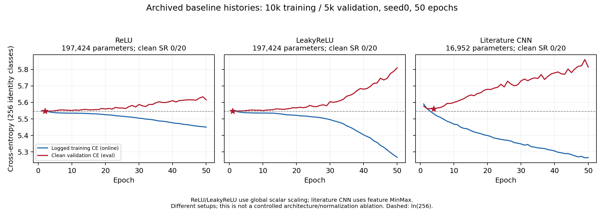
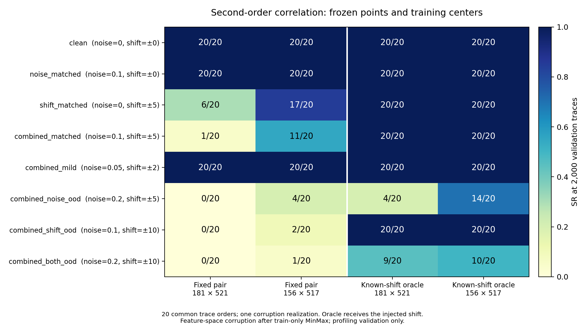
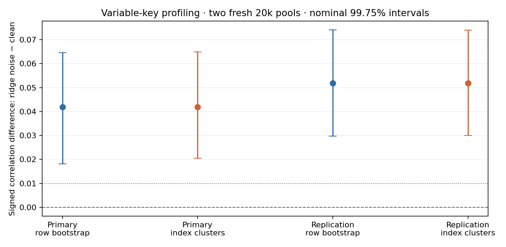
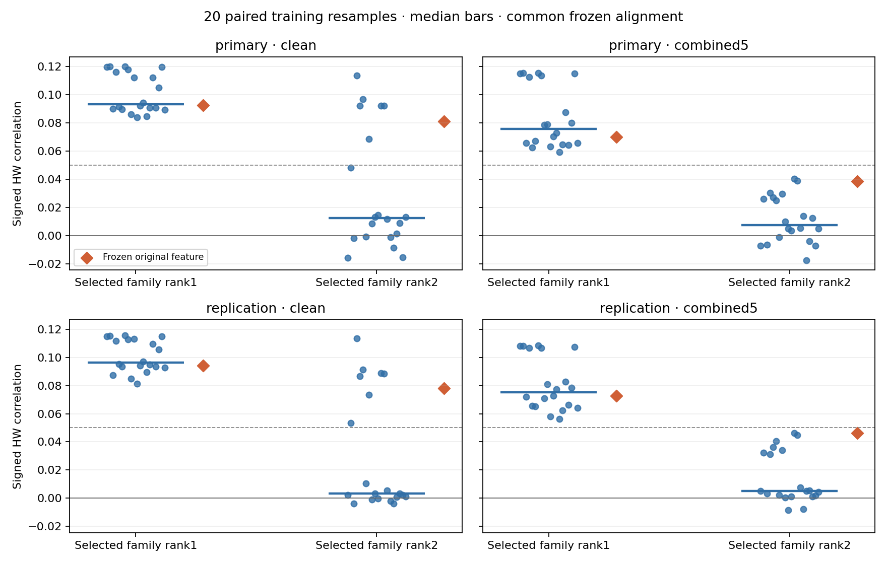
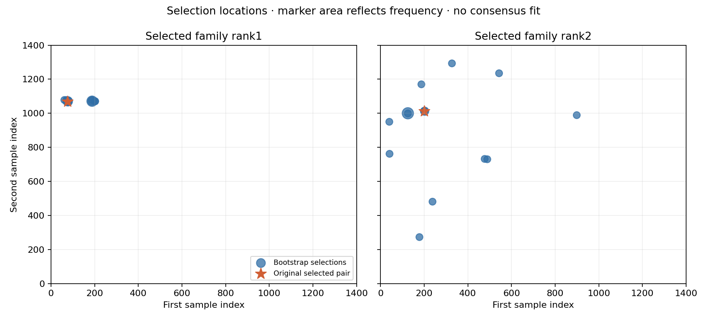

# Νευρωνικά δίκτυα και διαρροή masked AES: διαγνωστική μελέτη περιορισμένου κόστους

Προσωρινή ελληνική ερευνητική αναφορά για το μάθημα Hardware Security.
Κατάσταση: **2026-10-11**. Πρόκειται για σύνθεση των εκτελεσμένων πειραμάτων,
όχι για ολοκληρωμένη μελέτη augmentation ή επιβεβαιωμένη συνεισφορά paper.

Ενημέρωση της5/10: η [αναπαραγωγή σε καθαρό CPU περιβάλλον](../cpu_reproduction_2026-10-05/REPORT_EL.md)
ολοκληρώθηκε μετά την αρχική σύνθεση, χωρίς νέα GPU εκπαίδευση. Βλ. §11 για το scope.
Με νεότερη εντολή χρήστη εκτελέστηκαν [τρεις πρόσθετες CPU ερευνητικές φάσεις](../paper_extension_2026-10-05/REPORT_EL.md)
και ενσωματώθηκαν στη §12. Η έρευνα προς πιθανό paper συνεχίζεται χωρίς επιβεβαιωμένη πρωτοτυπία.
Στη συνέχεια ολοκληρώθηκε [τέταρτη CPU φάση με SAD και correspondence control](../paper_alignment_controls_2026-10-05/REPORT_EL.md),
ενσωματωμένη στη §13. Η γνωστή SAD ισοφαρίζει το κύριο Gaussian SR endpoint.
Η [πέμπτη CPU φάση σε νέο ASCAD campaign/attack key](../paper_variable_campaign_2026-10-05/REPORT_EL.md)
ενσωματώθηκε στη§14: η combined5 επιτυχία δεν επαναλήφθηκε και το criterion απέτυχε.
Στις6/10 προστέθηκε [έκτη CPU φάση selected-signal replication/permutation audit](../paper_selection_audit_2026-10-06/REPORT_EL.md),
στη§15. Τρία από τέσσερα παγωμένα pairs επανέλαβαν signed συσχέτιση σε φρέσκο profiling.
Στη συνέχεια προστέθηκαν [window/noise regression](../paper_window_regression_2026-10-06/REPORT_EL.md)
και [μεγαλύτερη επιβεβαίωση χωρίς νέο fit](../paper_precision_replication_2026-10-06/REPORT_EL.md),
στις§16–17. Νέα1.260correlation comparisons/540recovery summaries·82tests passed.
Τα γνωστά window baselines αποκαθιστούν fixed-key OOD recovery, ενώ variable-key
attack παραμένει κάτω από τοcriterion. Η πρωτοτυπία παραμένει ανεπιβεβαίωτη.

## Περίληψη

Μελετήσαμε την ανάκτηση ενός AES key byte από δημόσιες πραγματικές μετρήσεις του
ASCAD fixed-key, με 10.000 training traces, 5.000 validation traces, ένα seed και
περιορισμό στις GPU εκπαιδεύσεις. Τρία CNN baselines ολοκλήρωσαν 50 epochs αλλά
δεν ανέκτησαν το byte σε καμία από τις 20 clean validation επαναλήψεις με budget
2.000 traces. Το προαποφασισμένο κριτήριο επιτυχίας απέτυχε, οπότε η εκπαίδευση
combined augmentation δεν εκτελέστηκε.

Οι CPU διαγνώσεις δείχνουν ότι η αποτυχία του τελευταίου CNN συνυπάρχει με αξιοποιήσιμη
δεύτερης τάξης διαρροή: correlation scoring σε δύο training-selected centered
products έδωσε 20/20 clean validation ανακτήσεις. Οι σταθερές θέσεις είναι ευαίσθητες
σε τεχνητές μετατοπίσεις. Με σ=0,1 και shifts±5 οι επιτυχίες πέφτουν σε 1/20 και 11/20·
γνωστή oracle διόρθωση επαναφέρει 20/20. Αυτό είναι διαγνωστικό control, όχι πρακτική
ευθυγράμμιση. Οι μέθοδοι έχουν διαφορετική profiling information και δεν αποτελούν
δίκαιη σύγκριση υπεροχής CNN/correlation. Δεν χρησιμοποιήθηκε το αρχικό fixed-key attack set.

Η επέκταση εξέτασε πρακτική trace-only εκτίμηση μετατόπισης, normalization coordinates
και επιλογή σημείων μόνο με training labels. Στο τρίτο χωριστό profiling confirmation,
raw shifts±5/σ=1,3: Gaussian alignment20/20 και18/20 ανακτήσεις έναντι fixed0/20 και0/20.
Στο δυσκολότερο±10/σ=2,6:6/20 και0/20. Οι νέες raw-unit αλλοιώσεις διαφέρουν από
την παλιά feature-space sensitivity. Το αποτέλεσμα δεν τεκμηριώνει νέα τεχνική ή
cross-device/unknown-key γενίκευση.

Στη νέα variable-key καμπάνια, με νέο fit10k και διαφορετικό πραγματικό attack key,
Gaussian clean15/20 και0/20, combined5 0/20 και0/20. Το ίδιο primary criterion απέτυχε.
Μεταβάλλονται καμπάνια, φυσική χρονική μεταβλητότητα, window και απόλυτα noise units·
δεν απομονώνεται μόνο το key effect. Δεν τεκμηριώνεται γενική robustness υπεροχή.

Το νέο profiling-only audit της6/10 διατηρεί τα τέσσερα επιλεγμένα pairs και
επιβεβαιώνει signed συσχέτιση σε τρία. Το δεύτερο variable-key pair δεν πέρασε
το corrected criterion, παρότι είχε ασθενή συσχέτιση ίδιου προσήμου στη νέα pool.
Το πρώτο variable-key pair επανέλαβε profiling signal και είχε αποτύχει στην παλιά
combined επίθεση· δεν εξηγείται όλη η αποτυχία μόνο από μη διατήρηση των σημείων.

Οι επόμενες φάσεις έδειξαν ότι απλά window/box/rank1 controls αξιοποιούν το
fixed-key signal υπό τις συγκεκριμένες τεχνητές αλλοιώσεις. Η noise correction
βελτίωσε ορισμένα profiling endpoints έναντι clean ridge, αλλά δεν υπερέχει των
απλών controls. Η variable-key attack αξιολόγηση παρέμεινε στα 3/20–4/20, κάτω
από τον στόχο 18/20. Το training-side alignment και η επανεπιλογή του δεύτερου
pair απέτυχαν στα προκαθορισμένα κριτήρια, παρότι συγκεκριμένα frozen pairs
διατήρησαν θετικό signal.

Η φάση 11 άλλαξε μόνο τον στόχο της training-only επιλογής: από γινόμενα σημείων
σε γινόμενα μέσων παραθύρων. Στα ίδια 20 ζευγαρωμένα draws και δύο νέες ομάδες
profiling των 10.000 rows, η πρώτη οικογένεια βελτιώθηκε περιγραφικά. Η δεύτερη
έδωσε διαμέσους 0,007642 και 0,006647, με 12/20 και 13/20 θετικά draws· το κύριο
κριτήριο απέτυχε. Η αλλαγή του στόχου δεν αρκεί για σταθερό δεύτερο signal.
Δεν αποδεικνύεται μοναδική αιτία της αποτυχίας ή false positive του αρχικού pair.

Η ισχυρότερη σημερινή συνεισφορά είναι benchmark και failure analysis, με παγωμένα
πρωτόκολλα, αρνητικά αποτελέσματα και χωριστούς αριθμητικούς ελέγχους. Η πρωτοτυπία
και η αξιόπιστη ανάκτηση σε ανεξάρτητο πραγματικό key παραμένουν ανοικτές.
Με νεότερη άδεια χρήστη εκτελέστηκε μία τέταρτη GPU baseline του ίδιου CNN:
batch 50 και author linear OneCycle, με ίδια 10k/5k/seed0/50 epochs. Τα updates
αυξήθηκαν 3.950 → 10.000, αλλά clean validation SR@2000 παρέμεινε 0/20.
Η συγκεκριμένη αλλαγή recipe δεν αρκεί στο περιορισμένο training sample.
Στις11/10, η χωριστά εγκεκριμένη baseline45k αποκατέστησε clean validation recovery:
20/20 στα2.000traces, GE0, minimum-CE epoch21, με ίδιοCNN/seed/50epochs/batch50/cycle.
Η κοινή αλλαγή unique samples/updates/scaler δεν απομονώνει αιτία· αξιολογείται το
ίδιο ήδη viewed validation, χωρίς independent attack claim. Βλ.§23.
Το τελευταίο suite έχει105 passing tests. Παραμένουν ένα ενεργό continuation Kaggle
notebook στονnmavros, preservedcon1loshistory, πέντε full GPU εκπαιδεύσεις/cap5 και
30.000 αχρησιμοποίητες variable profiling rows. Combined training δεν εκτελέστηκε.

## 1. Στόχος και βασικές έννοιες

Ένα trace είναι η ακολουθία μετρήσεων φυσικής διαρροής κατά την εκτέλεση AES σε hardware.
Το νευρωνικό δίκτυο λαμβάνει μόνο αυτή την ακολουθία και προβλέπει 256 πιθανότητες
για την τιμή ενός ενδιάμεσου byte. Το γνωστό plaintext επιτρέπει να μετατρέψουμε
αυτές τις πιθανότητες σε scores για 256 υποψήφια key bytes. Η συσσώρευση πληροφορίας
από πολλά traces αποσκοπεί στο να φέρει πρώτο το σωστό byte. Δεν επιχειρούμε
ανάκτηση ολόκληρου του AES key.

Το masking χωρίζει την ευαίσθητη τιμή σε τυχαία καλυμμένες ποσότητες. Η σύνδεση
με το μη καλυμμένο byte μπορεί να απαιτεί συνδυασμό διαφορετικών χρονικών σημείων.
Ο έλεγχος δεύτερης τάξης εδώ χρησιμοποιεί προϊόν δύο κεντραρισμένων μετρήσεων.
Τέτοιες στατιστικές επιθέσεις έχουν ήδη μελετηθεί· δεν εισάγουμε νέα τεχνική.
[Prouff–Rivain–Bévan, revised primary record](https://eprint.iacr.org/2010/646).

Το αρχικό ερευνητικό ερώτημα ήταν: με λίγα μοναδικά training traces και κοινό αριθμό
updates, βοηθά ο συνδυασμός Gaussian noise και χρονικών μετατοπίσεων σε αλλοιώσεις
διαφορετικών εντάσεων; Αυτό παραμένει **αναπάντητο**, επειδή δεν υπάρχει trained
combined comparator. Το ερώτημα που εξετάζει αυτή η αναφορά είναι πιο στενό:
τι αποκαλύπτουν τα παγωμένα διαγνωστικά για τα αποτυχημένα CNN baselines και για
την ευαισθησία της υπάρχουσας διαρροής στις συγκεκριμένες αλλοιώσεις;

## 2. Δεδομένα, attacker και διαχωρισμός

Χρησιμοποιήσαμε το επίσημο προεπεξεργασμένο ASCAD fixed-key,700 samples ανά trace,
zero-based byte2, με identity labels `Sbox(plaintext[2] XOR key[2])`.
Η προέλευση και το schema ελέγχονται από το [επίσημο repository](https://github.com/ANSSI-FR/ASCAD).
Το τοπικό HDF5 έχει 50.000 profiling και 10.000 attack traces. Για το κύριο scope
επιλέξαμε 10.000 training και 5.000 validation rows από το profiling, splitseed 2026.
Τα αποθηκευμένα indices είναι διακριτά και κοινά στα τρία baselines. Οι υπόλοιπες
profiling rows δεν αυξάνουν το εγκεκριμένο training budget.

Ο profiling attacker υποτίθεται ότι έχει γνωστές τιμές στην ελεγχόμενη profiling
συσκευή. Το CNN δεν λαμβάνει key, plaintext ή mask metadata ως inputs. Στο scoring
το plaintext χρησιμοποιείται για τις candidate hypotheses, το σωστό validation
key μόνο για το πραγματικό rank. Η παλιότερη επιλογή των correlation points
χρησιμοποίησε επιπλέον training mask/share metadata· αυτή η προνομιακή πληροφορία
καταγράφεται και δεν αποδίδεται στο CNN.

Το fixed-key campaign δεν αποδεικνύει μεταφορά σε νέο άγνωστο key ή άλλη συσκευή.
Το 700-point window είναι ήδη προεπιλεγμένο από τους δημιουργούς του dataset.
Όλα τα κύρια αποτελέσματα αυτής της αναφοράς προέρχονται από **profiling validation**,
το οποίο έχει επανειλημμένα χρησιμοποιηθεί για διάγνωση. Δεν είναι ανεξάρτητο τελικό test.
Το final attack παραμένει κλειστό· δεν εμφανίζουμε validation scores ως attack results.

Dataset SHA-256: `f56625977fb6db8075ab620b1f3ef49a2a349ae75511097505855376e9684f91`.
Split ID: `1c9656f9ba13791a7ba4781a5518420f4fef4e303c979d4c307cc6ed27ee9090`.

## 3. CNN πρωτόκολλο και πραγματική εκτέλεση

Κάθε baseline χρησιμοποίησε seed 0,50 epochs, batch 128, Adam LR 0,001 και 10k/5k split:
79 updates ανά epoch,3.950 συνολικά. Το checkpoint επιλέχθηκε από την ελάχιστη
**clean validation cross-entropy**, πριν από τον έλεγχο ανάκτησης. Δεν επιλέγουμε
epoch από final attack ή αλλάζουμε τον κανόνα για να περάσει το gate.

| Baseline | Parameters | Κανονικοποίηση | Best epoch | Minimum validation CE | Clean GE@2000 | Clean SR@2000 |
|---|---:|---|---:|---:|---:|---:|
| ReLU |197.424|Training-only global scalar|2|5,547229|103,50|0/20|
| LeakyReLU0,1 |197.424|Training-only global scalar|1|5,547114|89,25|0/20|
| Literature-inspired CNN |16.952|Training-only feature MinMax|4|5,560782|114,25|0/20|

Το τελευταίο CNN έχει Conv1d1→4/kernel 1, SELU/BatchNorm, AvgPool2 και dense 10→10→256
logits. Τα ReLU/Leaky αποτελέσματα διατηρούνται ως αρνητικά αποτελέσματα. Η αλλαγή
normalization/architecture στην τρίτη έκδοση σημαίνει ότι η σύγκριση και των τριών
δεν απομονώνει την επίδραση ενός παράγοντα. Η μικρότερη CE ή GE ανάμεσα σε failures
δεν αρκεί για να ονομάσουμε ένα επιτυχές ή σταθερά ανώτερο μοντέλο.

Το gate για combined ήταν cleanSR≥0,90, δηλαδή 18/20, στο original minimum-CE
checkpoint. Παρατηρήθηκε 0/20. Το combined παραλείφθηκε, χωρίς single noise/shift
trainings ή αυτόματο search. Άρα δεν μετρήθηκαν augmentation effect, combined
overhead ή factorial interaction.



Οι καμπύλες training CE υπολογίστηκαν online μέσα στον training loop, ενώ validation
CE σε eval mode. Δεν είναι frozen-forward μέτρηση του ίδιου checkpoint στο training
set. Η ξεχωριστή CPU διάγνωση παρακάτω χρησιμοποιεί frozen-forward CE.
Η πτώση training CE και άνοδος validation CE είναι συμβατή με ανεπαρκή γενίκευση
του setup, αλλά δεν εντοπίζει από μόνη της μία μοναδική αιτία.

## 4. Ποια διαγνωστικά εκτελέστηκαν

Τα best/last checkpoints του literature CNN αξιολογήθηκαν σε CPU χωρίς νέα weight
updates. Η ελεγμένη, παγωμένη CE στο training ήταν 5,516667 για best και 5,240488
για last· στο validation5,560782 και 5,814250. Έλεγχοι label shuffles έδειξαν
training alignment χωρίς αντίστοιχο held-out alignment. Οι 10 dense μονάδες έχουν
μεταβλητά outputs, επομένως το τελευταίο failure δεν εξηγείται απλώς από πλήρη
σταθεροποίηση των outputs. Διατηρείται mask/share signal στη hidden representation,
ενώ η ένδειξη για τον unmasked στόχο παραμένει χαμηλή.

Ελέγχθηκε BatchNorm με training-only exact moments σε frozen-weight clones.
Δεν άλλαξαν τα αρχικά checkpoints. Η validation CE έγινε 5,569355(best) και
5,814538(last), με SR0/20 και στα δύο. Αυτό αποκλείει ως επαρκή λύση τον συγκεκριμένο
BN recalibration έλεγχο· δεν αποκλείει κάθε πιθανή αλλαγή training recipe.

Στη δεύτερης τάξης διάγνωση επαναχρησιμοποιήθηκαν τα υπάρχοντα training-selected
ζεύγη 181×521 και 156×517, χωρίς validation point search. Τα προϊόντα συσχετίζονται
με `HW(Sbox(plaintext_byte XOR candidate_key))` για κάθε υποψήφιο byte.
Η απόλυτη Pearson correlation δίνει τη βαθμολογία. Τα true-key ranks, GE, SR και
sustainedSR90 προκύπτουν από 20 κοινές σειρές των validation traces.

| Παγωμένο ζεύγος | Clean GE@2000 | Clean SR@2000 | Πρώτο sustainedSR90 prefix |
|---|---:|---:|---:|
|181×521 (rout)|0|20/20|631traces|
|156×517 (r3)|0|20/20|481traces|

Ο συνδυασμός διαρροών είναι αξιοποιήσιμος στο συγκεκριμένο validation. Δεν
συμπεραίνουμε ότι κάθε CNN αδυνατεί να τον μάθει, ότι correlation είναι καθολικά
ανώτερη ή ότι η επιτυχία θα μεταφερθεί σε νέο device/key. Τα δύο ζεύγη δεν
συνδυάστηκαν σε νέο classifier και δεν επιλέχθηκε validation winner.

## 5. Θόρυβος, shifts και oracle control

Οι οκτώ εντάσεις είχαν οριστεί στο υπάρχον evaluation grid. Χρησιμοποιήθηκαν
train-only feature MinMax, παγωμένα normalized training centers, seed 9001, batch 256,
shift→noise και 20 common orders/seed 8001. Αυτό είναι **evaluation αλλοιώσεων**,
όχι single-strategy training. Κάθε κελί παρακάτω αναφέρει επιτυχίες/20 στο budget 2000.

| Συνθήκη (σ; shift range) |Fixed181×521|Fixed156×517|Oracle181×521|Oracle156×517|
|---|---:|---:|---:|---:|
|Clean (0;0)|20/20|20/20|20/20|20/20|
|Noise matched (0,1;0)|20/20|20/20|20/20|20/20|
|Shift matched (0;±5)|6/20|17/20|20/20|20/20|
|Combined matched (0,1;±5)|1/20|11/20|20/20|20/20|
|Combined mild (0,05;±2)|20/20|20/20|20/20|20/20|
|Combined noise OOD (0,2;±5)|0/20|4/20|4/20|14/20|
|Combined shift OOD (0,1;±10)|0/20|2/20|20/20|20/20|
|Combined both OOD (0,2;±10)|0/20|1/20|9/20|10/20|

Το oracle διαβάζει τις θέσειςpoint+δ με τη **γνωστή injected μετατόπιση** του trace.
Δεν εκτιμά τη δ από μετρήσεις. Η επαναφορά σε 20/20 για σ=0,1 είναι διαγνωστική
ένδειξη ότι η θέση των features περιορίζει τη σταθερή εξαγωγή. Δεν αποτελεί learned
shift invariance ή έτοιμη πρακτική επίθεση. Στο σ=0,2 ούτε η oracle εξαγωγή φτάνει
18/20. Δεν βελτιστοποιήθηκαν οι εντάσεις ή τα ζεύγη από τις τωρινές επιδόσεις.



Τα selected products είναι ακριβώς ίδια με zero και edge padding, καθώς τα σημεία
είναι εσωτερικά και κανένα δεν αποκόπηκε μέχρι±10. Αυτό δεν αποκλείει border cues
σε CNN που διαβάζει 700 points. Οι μετατοπίσεις/θόρυβος εφαρμόστηκαν **μετά** το
per-position MinMax και δεν ισοδυναμούν με physical raw jitter/noise πριν από αυτό.

Οι μέθοδοι μέσα σε κάθε συνθήκη έχουν ίδια corrupted traces. Οι σειρές traces
είναι κοινές σε όλες τις συνθήκες, αλλά το interleaved RNG δεν εγγυάται κοινά
offsets μεταξύ διαφορετικών συνθηκών. Για παράδειγμα, η διαφορά shift-only/combined
δεν απομονώνει αποκλειστικά τον θόρυβο. Δεν συμπεραίνουμε μονοτονική dose-response
από τις OOD διαφορές μίας corruption realization.

## 6. Μετρικές και αβεβαιότητα

Rank0 σημαίνει πρώτο υποψήφιο. GE είναι ο μέσος rank και SR το ποσοστό σειρών που
καταλήγουν στοrank0. Το CNN συσσωρεύει log probabilities. Η correlation χρησιμοποιεί
absolute prefix scores και συντηρητικά ties με tolerance1e−12. Οι δύο score methods
διαφέρουν και δεν συγκρίνονται ως CE. SustainedSR90 σημαίνειSR≥0,90 σε όλα τα
επόμενα prefixes μέχρι το budget, όχι μία μεμονωμένη πρώτη επιτυχία. Τα failures
καταγράφονται ως μη επίτευξη εντός 2000, όχι ως πλασματική επιτυχία στα 2000.

Οι 20 σειρές περιέχουν αλληλεπικαλυπτόμενα traces από κοινό pool· δεν είναι 20training
seeds ή ανεξάρτητες φυσικές campaigns. Τα τρία CNNs έχουν ένα κοινό training seed,
όχι επαναλήψεις της ίδιας αρχιτεκτονικής. Δεν αναφέρουμε confidence intervals ή
μεταβλητότητα μεταξύ trainings, corruption seeds ή συσκευών που δεν μετρήθηκαν.
Τα label/product shuffle controls είναι περιγραφικά, όχι αυτόματοι p-values.

## 7. Βιβλιογραφία και τι μπορεί να θεωρηθεί συνεισφορά

Noise/shifting augmentation και τα όρια CNN shift robustness έχουν ήδη προηγούμενο.
Η εργασίαLi–Perin του 2024 εξετάζει countermeasures χωριστά και αναφέρει joint
strategies ως future work· αυτό δεν πιστοποιεί σημερινό κενό.
[Publisher full text](https://link.springer.com/article/10.1007/s13389-024-00363-3).
Η εργασίαKrček et al. μελετά shift robustness και augmentation ensembles.
[Preprint](https://eprint.iacr.org/2023/1100.pdf),
[publisher record](https://www.mdpi.com/2227-7390/12/20/3279).

Το EquivSCA προσθέτει shift/temporal-scale equivariant αρχιτεκτονική με διαφορετικό
training/epoch-selection πρωτόκολλο. Το RFA-SCA χρησιμοποιεί unlabeled target
adaptation, δηλαδή διαφορετική πρόσβαση σε target data από τη δική μας.
[EquivSCA preprint](https://eprint.iacr.org/2025/1379.pdf),
[RFA-SCA publisher PDF](https://file.techscience.com/files/onlinefirst/2026/6.11/TSP_CMC_81308/TSP_CMC_81308.pdf).
Η σχέση centered products και ευθυγράμμισης επίσης έχει προηγούμενο.
[Second-order Scatter Attack](https://eprint.iacr.org/2019/345.pdf).

Η τρίτη CNN εκτέλεση είναι προσαρμογή της μικρής αρχιτεκτονικής τουZaid et al.,
όχι ακριβής αναπαραγωγή αποτελεσμάτων. Ο δημόσιος κώδικας ορίζει 45ktrain/batch 50/
OneCycle max LR 0,005, ενώ εμείς 10k/batch 128/constantLR0,001. Από αυτά προκύπτουν
45.000 έναντι 3.950 updates για 50 epochs, περίπου 11,39 φορές λιγότεροι δικοί μαςupdates.
Αυτή είναι δική μας αριθμητική σύγκριση· δεν αποδεικνύει αιτία failure ή ότι περισσότερα
updates θα το διορθώσουν. Η training-only κανονικοποίηση διατηρείται.
[Author code](https://github.com/gabzai/Methodology-for-efficient-CNN-architectures-in-SCA/blob/master/ASCAD/N0%3D0/cnn_architecture.py).

Με τα σημερινά δεδομένα, η τεκμηριωμένη συνεισφορά είναι **αναπαραγώγιμη πανεπιστημιακή
μελέτη περίπτωσης**: negative CNN results, diagnostics και περιορισμοί συγκεκριμένου
feature-space corruption protocol. Δεν επιβεβαιώνεται νέα μέθοδος, όφελος augmentation
ή δημοσιεύσιμο ερευνητικό κενό. Ο [πίνακας βιβλιογραφίας](../../literature/REVIEW.md)
και ο [στοχευμένος έλεγχος της 5/10](../../literature/PRIMARY_AUDIT_2026-10-05.md)
καταγράφουν authors/venue/DOI, πρόσβαση, διαφορές και εκκρεμότητες. Η αναζήτηση δεν ήταν
εξαντλητική· final chapters, code URLs και forward-citation gaps δεν ερμηνεύονται ως
απουσία εργασιών. Δεν αγοράστηκε πρόσβαση.

## 8. Πραγματικό κόστος και αναπαραγωγιμότητα

| Ολοκληρωμένο training | GPU | Epochs / steps | Training-loop seconds | Validation-loop seconds |
|---|---|---:|---:|---:|
|ReLU|TeslaT4|50/3.950|18,08|3,49|
|LeakyReLU|TeslaT4|50/3.950|19,11|3,93|
|Literature CNN|TeslaT4|50/3.950|14,85|3,42|
|Σύνολο|Ίδιος τύπος GPU|150/11.850|52,04|10,84|

Οι χρόνοι είναι synchronized epoch loops με transfers και augmentation, όχι πλήρες
Kaggle elapsed time. Δεν περιλαμβάνουν container startup, εγκαταστάσεις, ελέγχους,
HDF5 inspection και checkpoint I/O. Δεν ανασυνθέσαμε αξιόπιστο συνολικό κόστος όλων
των sessions από αυτούς τους αριθμούς. Ενδεικτικά η τελευταία εκτέλεση είχε log
μέχρι 300,285 s, με πολύ μεγαλύτερο setup κόστος από τον training loop. Οι πρώτες 3
benchmark epochs του αρχικού baseline επαναχρησιμοποιήθηκαν στις 50 και δεν
μετρήθηκαν ως πρόσθετο πλήρες training.

Η CPU sensitivity μέτρηση χρειάστηκε 47,52 s και η ανεξάρτητη επαλήθευση 6,07 s.
Αυτοί οι χρόνοι δεν προστίθενται σε GPU timings σαν κοινή compute σύγκριση.
Η παρούσα σύνθεση διαβάζει υπάρχοντα JSON/checksums, δεν ξανατρέχει εκπαίδευση
ή ανάκτηση. Συνολικά παραμένουν 3 πλήρη GPU trainings και 1 Kaggle notebook.
Ο source fingerprint είναι
`84eff3cde04c0e9a1756a3d29c44ec82e115a1a08575132686a02520333e2b5c`.

Κατά την αρχική σύνθεση, το τελευταίο πλήρες suite είχε 44 tests passed/14 υπάρχοντα deprecation warnings σε 32,51 s.
Οι CPU ranks επαληθεύτηκαν με ανεξάρτητο Pearson formula και production corruption
replay,640endpoints. Συνθετικά tests ελέγχουν κώδικα και όχι φυσική αποτελεσματικότητα.
Στη συνεδρία σύνθεσης δεν άλλαξαν labels/ranking/splits/transforms/checkpoints,
οπότε δεν δηλώνουμε νέα εκτέλεση του full suite. Ελέγχθηκαν απευθείας οι πίνακες,
οι πηγές τους και η διατήρηση των παγωμένων artifacts.

## 9. Συγκεκριμένη συνέχεια μέσα στο ισχύον όριο

Προτεινόμενη συνέχεια χωρίς νέα GPU εκπαίδευση: να χρησιμοποιήσουμε αυτή τη
διαγνωστική κατεύθυνση ως προσωρινό άξονα της πανεπιστημιακής εργασίας και να
χρησιμοποιήσουμε την ολοκληρωμένη αναπαραγωγή από καθαρό περιβάλλον, την ελεγμένη
βιβλιογραφία και την εξήγηση του threat model στην τελική επιμέλεια. Το αρχικό augmentation ερώτημα καταγράφεται ως
μη απαντημένο λόγω failed baseline gate· δεν αφαιρείται από το ιστορικό.

| Επιλογή συνέχειας | Πρόσθετα πλήρη GPU trainings | Τι μπορεί να απαντήσει | Κατάσταση |
|---|---:|---|---|
|Σύνθεση/αναπαραγωγή υπάρχοντων αποτελεσμάτων|0|Διαγνωστική μελέτη αυτού του setup και των ορίων του|Ολοκληρώθηκε· απομένει τελική επιμέλεια|
|Πρακτική ευθυγράμμιση από traces|0 κατ' αρχήν|Εκτίμηση shifts χωρίς γνωστήδ και diagnostic robustness|Δεν υλοποιήθηκε· απαιτεί ξεχωριστό παγωμένο πρωτόκολλο|
|Νέο CNN recipe baseline και conditional combined|1baseline +1combined αν περάσει|Αρχικό none/combined ερώτημα σε νέο setup|Σύνολο μπορεί να γίνει5· απαιτεί αλλαγή scope/ορίου και συμφωνία|

Απομένει μία πλήρης GPU εκπαίδευση κάτω από το cap4. Αυτό **δεν αρκεί** για νέο
baseline και επιτυχημένο conditional combined. Ο χρήστης στη συνέχεια ενέκρινε
πειράματα προς paper· εκτελέστηκε η CPU επέκταση της§12, διατηρώντας GPUcap4,
training10k και το CNN checkpoint rule. Δεν υποβλήθηκε νέο GPU run.
Η αρχική σύσταση είναι δική μας κρίση από τα ευρήματα, όχι κριτήριο
του καθηγητή ή εγγύηση αξιολόγησης. Δεν έχει δοθεί συγκεκριμένη ημερομηνία παράδοσης·
ο χρήστης ανέφερε διαθέσιμο εξάμηνο και απουσία κριτηρίων αξιολόγησης.

Για paper θα χρειαστεί να καθοριστεί ξεχωριστή νέα συνεισφορά και ισχυρότερη
επιβεβαίωση· η σημερινή αναφορά δεν προεξοφλεί τέτοιο αποτέλεσμα.

## 10. Αρχεία και επανάληψη της σύνθεσης

Η [evidence.json](evidence.json) συγκεντρώνει τους αριθμούς και SHA-256 κάθε
εισόδου. Ο companion `notebooks/build_study_synthesis.py` διαβάζει μόνο αποθηκευμένα
artifacts, επιβεβαιώνει 50 epochs/3.950 steps, minimum-CE selections, archive hashes,
κοινά split/data identifiers και το failed gate, και δημιουργεί το γράφημα ιστοριών.
Δεν ανοίγει HDF5 trace groups, δεν επιλέγει νέο μοντέλο και δεν καλεί Kaggle.

```powershell
& .\.venv\Scripts\python.exe notebooks/build_study_synthesis.py
```

Αναλυτικά τεκμήρια:

- [ReLU training και validation](../kaggle_baseline_v3_2026-10-03/REPORT_EL.md)
- [LeakyReLU training και validation](../kaggle_leaky_v5_2026-10-03/REPORT_EL.md)
- [Literature CNN training και gate](../kaggle_literature_v7_2026-10-03/REPORT_EL.md)
- [Masking/point selection](../masking_diagnosis_2026-10-03/REPORT_EL.md)
- [Frozen CNN και correlation diagnostics](../literature_diagnosis_2026-10-04/REPORT_EL.md)
- [Παγωμένη sensitivity, πλήρες GE/SR grid και oracle limits](../correlation_robustness_2026-10-05/REPORT_EL.md)
- [Πρωτόκολλο](../../docs/EXPERIMENT_PROTOCOL.md), [βιβλιογραφία](../../literature/REVIEW.md)

Τα προσωπικά credentials, το HDF5, τα run checkpoints και τα environments παραμένουν
εκτός Git. Η [verification.json](verification.json) καταγράφει την επαλήθευση της
σύνθεσης και τη διατήρηση του ενεργού notebook/checkpoint/packet.

## 11. Συμπληρωματικός έλεγχος αναπαραγωγής σε καθαρό CPU venv

Δημιουργήθηκε νέο περιβάλλον από27 exact wheels με hashes και ξεχωριστό αντίγραφο
του frozen source. Επαληθεύτηκαν imports/dependencies με `python -I` και πέρασε
το pip check. Το πλήρες suite πέρασε ξανά: **44 passed/14 warnings σε597,51s**.
Αυτό είναι η μεταγενέστερη εκτέλεση αναπαραγωγής, ξεχωριστή από τον αρχικό χρόνο32,51s.

Τα literature CNN best/last training και clean validation CE/accuracy συμφωνούν
ακριβώς με την προηγούμενη CPU διάγνωση, μαζί με80.000 prefix ranks. Τα δύο raw
correlation ζεύγη διατηρούν20/20 επιτυχίες και άλλους80.000 ίδιους prefix ranks.
Και οι32 sensitivity rows και138 arrays έχουν ίδια dtype/shape/bytes· ξαναπέρασαν
640 ανεξάρτητοι Pearson endpoint έλεγχοι. Το real-data CPU replay πήρε62,36s μετά imports.

Δεν επαναλήφθηκαν historical ReLU/LeakyReLU inference, BN counterfactual/shuffled
controls ή η επιλογή σημείων. Δεν έγιναν real-data optimization, νέαGPU εκτέλεση
ή final attack payload reads. Το original minimum-CE CNN gate παραμένειfailed,
combined skipped· σύνολο3 fullGPU trainings/1canonical Kaggle notebook.

Πρόκειται για checkpoint/diagnostic αναπαραγωγή στο ίδιο Windows host/base interpreter,
όχι νέα GPU training, cross-device ή unknown-key επιβεβαίωση. Οι ίδιοι oracle και
profiling-information περιορισμοί ισχύουν. Η καθαρή εγκατάσταση δεν προσθέτει
τεκμήριο οφέλους training augmentation ή novelty.

Αναλυτικά [μετρήσεις και όρια](../cpu_reproduction_2026-10-05/REPORT_EL.md),
[επαλήθευση](../cpu_reproduction_2026-10-05/verification.json) και
[οδηγίες](../../docs/CPU_REPRODUCTION.md). Τα νέα τεκμήρια διατηρούνται χωριστά
από το evidence.json της αρχικής σύνθεσης.

## 12. Επέκταση πειραμάτων προς πιθανό paper

Με εντολή χρήστη της5/10, προστέθηκαν τρεις πραγματικές CPU φάσεις στην εργασία:
trace-only NCC/Gaussian alignment, coordinate-consistent comparison raw/feature
shift και επιλογή δεύτερης τάξης σημείων μόνο από training identity labels/HW.
Διατηρήθηκαν train10k/validation5k· οι τρεις confirmation pools5k είναι disjoint,
με δικά τους plans παγωμένα πριν την αντίστοιχη εκτέλεση. Η επιλογή στην τρίτη
φάση δεν διάβασε training mask/share/key metadata ούτε validation/confirmation.

| Πείραμα | Gaussian raw combined5 SR@2.000 | Fixed SR | Κρίσιμο όριο |
|---|---|---|---|
| Φάση1, παλιά181×521/156×517, confirmation1 | 20/20,20/20 | 0/20,0/20 | Surrogate raw-domain scoring είχε coordinate confound |
| Φάση2, ίδια ζεύγη, corrected domain, confirmation2 | 11/20,20/20 | 0/20,0/20 | Το πρώτο20/20 δεν διατηρήθηκε και στα δύο |
| Φάση3, train-label-only156×521/182×547, confirmation3 | 20/20,18/20 | 0/20,0/20 | OODGaussian6/20,0/20· διαφορετική pool/σημεία |

Combined5 εδώ σημαίνει shift±5 και **ομοιόμορφο raw Gaussian σ=1,3**, όχι normalized
σ=0,1. OOD±10/σ=2,6. Τα20 orders επικαλύπτονται και αφορούν ένα key byte· δεν είναι
20training seeds/keys. Το γνωστό synthetic shift είναι μόνο diagnostic control.
Η coordinate correction ελέγχει λάθος centering/scales· δεν αποδεικνύει ότι η
σειρά normalization εξηγεί το clean CNN failure. Το αρχικό CNN augmentation
ερώτημα παραμένει αναπάντητο και το failed gate δεν αντικαταστάθηκε με CPA success.

Στην τρίτη φάση, Gaussian combined5 GE0/0,10 και sustainedSR90 στα899/1998 traces.
Clean20/20 και στα δύο. Στο OOD κανένα ζεύγος δεν έφτασε sustainedSR90 εντός2.000.
Αυτό είναι συγκεκριμένο εύρημα robustness με όρια· δεν αποτελεί γενική μέτρηση
υπεροχής της νέας επιλογής έναντι των προηγούμενων σε κοινή confirmation pool.

288 recovery summaries και5.760 ανεξάρτητοι CPA endpoints ελέγχθηκαν, μαζί με
576 sampled shift estimates και13 training pair coefficients. Πλήρες suite
57passed/14warnings σε19,43s. Οι τρεις CPU loops πήραν587,83s συνολικά μετά imports,
χωρίς tests/report/όλη τη συνεδρία. Νέα GPU trainings0, σύνολο3,1canonical notebook,
real-data optimizer updates0, original attack payload reads0 από αυτή την επέκταση.

Η βιβλιογραφία ήδη καλύπτει normalization/misalignment και second-order alignment.
Δεν τεκμηριώθηκε νέα τεχνική ή ακάλυπτο βιβλιογραφικό κενό. Παραμένει να καθοριστούν
κατάλληλες primary comparisons και independent campaign/key evidence για πιθανή
δημοσίευση. Οι τρεις confirmation pools έχουν πλέον εξεταστεί και δεν επαναχρησιμοποιούνται
ως αθέατες για επόμενες επιλογές.

[Πλήρης νέα αναφορά, δύο γραφήματα και κόστος](../paper_extension_2026-10-05/REPORT_EL.md),
[288 μετρήσεις](../paper_extension_2026-10-05/all_results.csv),
[evidence](../paper_extension_2026-10-05/evidence.json),
[verification](../paper_extension_2026-10-05/verification.json),
[primary audit](../../literature/PAPER_ALIGNMENT_AUDIT_2026-10-05.md).

## 13. SAD baselines και έλεγχος αντιστοίχισης shifts

Η τέταρτη CPU φάση πάγωσε το πρωτόκολλό της πριν την εκτέλεση, με τα ίδια training10k,
points156×521/182×547, raw conditions και κοινά RNG streams/orders. Νέο confirmation5k
seed20261008, χωριστό από train/validation και τις τρεις προηγούμενες confirmation pools.
Δεν έγινε νέο pair search. Το SAD reference επιλέχθηκε μόνο από training waveforms,
ως το πλησιέστερο στο training mean στο fixed window20:680, χωρίς labels/keys/masks.

| Μέθοδος | Combined5 pair1 SR | Combined5 pair2 SR | OOD pair1 SR | OOD pair2 SR |
|---|---:|---:|---:|---:|
| Fixed | 0/20 | 0/20 | 0/20 | 0/20 |
| NCC | 20/20 | 20/20 | 2/20 | 5/20 |
| Gaussian | 20/20 | 20/20 | 2/20 | 3/20 |
| SAD mean | 20/20 | 20/20 | 2/20 | 6/20 |
| SAD reference | 20/20 | 19/20 | 1/20 | 6/20 |
| Gaussian wrong row | 0/20 | 0/20 | 0/20 | 0/20 |
| Known shift | 20/20 | 19/20 | 1/20 | 4/20 |

Combined5=raw shift±5/σ1,3, OOD=±10/σ2,6. Wrong row σημαίνει deterministic roll των
Gaussian offsets κατά μία row, με ακριβώς ίδιο histogram και λανθασμένη αντιστοίχιση
trace/estimate. Η απώλεια20/20→0/20 στηρίζει τη σημασία σωστής αντιστοίχισης στην
παρούσα synthetic-shift περίπτωση. Το primary correspondence criterion πέρασε.

Η SAD είναι γνωστή objective, τεκμηριωμένη στο
[επίσημο ChipWhisperer API](https://chipwhisperer.readthedocs.io/en/latest/analyzer-api.html#chipwhisperer.analyzer.preprocessing.resync_sad.ResyncSAD).
Οι δικές μας train-mean/reference παραλλαγές διαφέρουν σε inclusive search, κοινό
tie rule και no rejection· δεν είναι exact package reproduction. SAD mean ισοφάρισε
Gaussian/NCC στο primarySR, συνεπώς δεν υπάρχει μετρημένη Gaussian υπεροχή σε αυτό
το endpoint ή νέα τεχνική. Prefix thresholds διαφέρουν χωρίς επιλογή ευνοϊκού metric:
Gaussian pair2 sustainedSR90 στα1606, SADmean1888, SADreference1300/endpoint19/20.

Όλες οι πρακτικές μέθοδοι απέτυχαν στοOOD threshold18/20. Global synthetic shifts
δεν καλύπτουν το δυσκολότερο elastic jitter/shuffling που ήδη διακρίνει το
[Second-order Scatter Attack §1.1](https://eprint.iacr.org/2019/345.pdf).
Στη φάση4 δεν εκτελέστηκαν Scatter/DTW ή ανεξάρτητη campaign/key αξιολόγηση.
Η μετέπειτα αξιολόγηση νέας καμπάνιας/κλειδιού περιγράφεται στη§14.

Η φάση πρόσθεσε112 summaries/2.240 independent execution endpoints και112 πρόσθετα
independent replays,256 sampled shift estimates. Πέρασαν61tests/14warnings σε14,88s.
Experiment loop136,87s/verifier5,90s μετάimports· τέσσερις CPU experiment loops724,71s,
400 summaries/8.000 execution endpoint checks συνολικά. Single-call inference timings
καταγράφονται χωριστά, χωρίς repeated variance ή σταθερό speedup claim.

Παγωμένος source/checkpoints/active Input/notebook διατηρήθηκαν. Νέα GPU trainings0,
σύνολο3/cap4/1notebook, original CNN gatefailed και combined absent, final attack reads0
από τη φάση4. Το τέταρτο confirmation πλέον έχει εξεταστεί και δεν ανακυκλώνεται ως
αθέατη επιβεβαίωση. Η Gaussian αναπαραγωγή επιτεύχθηκε με frozen pairs, αλλά η
same-key/campaign επιβεβαίωση δεν αρκεί για paper novelty ή cross-device claim.

[Αναφορά, κόστος και γράφημα](../paper_alignment_controls_2026-10-05/REPORT_EL.md),
[112 μετρήσεις CSV](../paper_alignment_controls_2026-10-05/all_results.csv),
[verification](../paper_alignment_controls_2026-10-05/verification.json),
[report verification](../paper_alignment_controls_2026-10-05/report_verification.json),
[primary baseline audit](../../literature/ALIGNMENT_BASELINES_2026-10-05.md).

## 14. Προοπτική επιβεβαίωση σε διαφορετική καμπάνια και κλειδί

Αποκτήθηκε το επίσημο αρχικό ASCAD variable-key,438.606.904bytes με επαληθευμένο
SHA-256. Profiling200k/attack100k,1400samples. Οι δημιουργοί περιγράφουν φυσική
ασυγχρονία σε αυτή την καμπάνια· χρησιμοποιήθηκε το original extracted αρχείο,
όχι desync50/100. [Επίσημη τεκμηρίωση](https://github.com/ANSSI-FR/ASCAD/blob/master/ATMEGA_AES_v1/ATM_AES_v1_variable_key/Readme.md).

Training10k/validation5k με seed2026, prospective attack5k με subsetseed20261009.
Το πρωτόκολλο και τα ζεύγη187×1080/334×573, training moments/variance πάγωσαν πριν
διαβαστούν validation ή attack τιμές. Η επιλογή χρησιμοποιεί μόνο training traces
και παρεχόμενα identity labels, με ίδιο separation50/diversity20 και προκαθορισμένο
interior margin10 για αποφυγή padding. Πρόκειται για νέο campaign-specific fit,
όχι zero-shot μεταφορά παλαιών σημείων/CNN ή απόδειξη διαφορετικής συσκευής.

Στις αξιολογημένες attack5k rows το πλήρες key είναι σταθερό, διαφορετικό από το
αρχικό, απόν από τα10.000 διαφορετικά training keys. Byte2=0x22, keys μόνο για
evaluation correctness/rank reporting. Δεν χρησιμοποιήθηκε simulated key ή
plaintext-key adjustment. Η αξιολόγηση αφορά ένα άγνωστο byte ενός νέου κλειδιού.

| Μέθοδος | Clean pair1 / pair2 | Shift5 pair1 / pair2 | Combined5 pair1 / pair2 | OOD pair1 / pair2 |
|---|---:|---:|---:|---:|
| Fixed | 10/20 / 0/20 | 0/20 / 0/20 | 0/20 / 0/20 | 0/20 / 0/20 |
| NCC | 14/20 / 0/20 | 14/20 / 0/20 | 0/20 / 0/20 | 0/20 / 0/20 |
| Gaussian | 15/20 / 0/20 | 15/20 / 0/20 | 0/20 / 0/20 | 0/20 / 0/20 |
| SAD mean | 12/20 / 0/20 | 12/20 / 0/20 | 0/20 / 0/20 | 0/20 / 0/20 |
| Gaussian wrong row | 3/20 / 0/20 | 0/20 / 0/20 | 0/20 / 0/20 | 0/20 / 0/20 |
| Known injected shift | 10/20 / 0/20 | 10/20 / 0/20 | 0/20 / 0/20 | 0/20 / 0/20 |

Budget2000/20 κοινές επικαλυπτόμενες σειρές/seed8001, ένα κλειδί και ένα training split.
Training median range48, συνεπώς combined5 raw±5/σ4,8 και OOD±10/σ9,6.
Τα relative noise factors0,1/0,2 είναι ίδια, αλλά οι απόλυτες εντάσεις διαφέρουν από
το fixed-key1,3/2,6. Φυσική ασυγχρονία/window/fitting/κλειδιά αλλάζουν μαζί·
δεν τεκμηριώνεται ότι μόνο η αλλαγή κλειδιού προκαλεί τη διαφορά. Known injected
shift αφαιρεί μόνο την πρόσθετη synthetic μετατόπιση, όχι την άγνωστη φυσική timing variation.

Και τα δύο primary criteria απέτυχαν: Gaussian SR0/20,0/20, GE105,90/164,55,
μηδενική SR improvement έναντι fixed στη combined5. Καμία γραμμή δεν έφτασε sustainedSR90.
Το δεύτερο pair δεν διατηρεί την training|r|≈0,038 στη clean validation, όπου r≈0,002.
Αυτό καταγράφει αστάθεια selected signal εκτός training· δεν αποδεικνύει από μόνο
του causal overfitting ή έλλειψη φυσικής διαρροής. Δεν αντικαταστάθηκε pair/μέθοδος
και δεν έγινε tuning από validation/attack. Η validation με varying keys είχε μόνο
descriptive HW correlations, όχι συσσώρευση ως υποτιθέμενο unknown fixed-key attack.

65tests passed/14warnings σε18,03s. 48νέα recovery summaries/960independent execution
endpoints,48additional replays,192sampled offset estimates,7real training coefficient checks.
Recorded CPU experiment92,26s μετάimports, fit1,82s περιλαμβανόμενο, verifier18,07s.
Πέντε paper φάσεις448summaries/8.960executionchecks/160additionalreplays,
816,97s συνολικού recorded CPU experiment time, όχι συνολικού session wall time.
Ένα synthetic test απέτυχε πριν οποιαδήποτε real-data ανάγνωση λόγω matrix slicing·
διορθώθηκε και διατηρήθηκαν failed test/παλιό plan με explicit correctness amendment.

Το νέο attack subset είναι πλέον viewed evidence και αποκλείεται από tuning.
Το αρχικό fixed-key attack payload δεν διαβάστηκε από αυτή την επέκταση. Source,
checkpoints/παλιά αρνητικά runs/failed gate/conditional combined/single notebook διατηρήθηκαν.
ΝέαGPU0, συνολικά3/cap4. Η προσπάθεια γενίκευσης απέτυχε· δεν θεμελιώνεται paper
νέας Gaussian μεθόδου ή γενικής robustness υπεροχής. Επόμενο ερώτημα είναι η
σταθερότητα/false-selection συμπεριφορά μόνο σε νέα profiling rows με νέο frozen plan.

[Πλήρης αναφορά και γράφημα](../paper_variable_campaign_2026-10-05/REPORT_EL.md),
[48μετρήσεις](../paper_variable_campaign_2026-10-05/recovery_summary.csv),
[independent verification](../paper_variable_campaign_2026-10-05/verification.json),
[report verification](../paper_variable_campaign_2026-10-05/report_verification.json),
[dataset/protocol audit](../../literature/VARIABLE_CAMPAIGN_2026-10-05.md).

## 15. Παγωμένα σημεία, τυχαία maxima και φρέσκο profiling confirmation

Στις6/10 προεγγράφηκε νέο diagnostic plan, με ίδια ιστορικά training10k και pairs,
χωρίς άλλο model/optimizer/budget/trainingseed.99 training-label permutations
ανά καμπάνια, με πλήρη αναζήτηση maximum|Pearson| στα211.575/885.115 αρχικά eligible
ζεύγη. Training moments/product variances επαναχρησιμοποιούνται. Το max null
δεν αφορά μόνο τα επιλεγμένα points: περιλαμβάνει την προηγούμενη πολλαπλή αναζήτηση.

Η calibration ολοκληρώθηκε πριν διαβαστούν νέες confirmation τιμές. Φρέσκο profiling5k
ανά campaign με seed20261010, excluded όλα τα προηγούμενα training/validation/
confirmation indices. Fixed35kexcluded→40kused,variable15kexcluded→20kprofilingused.
Καμία attack payload/key/mask/plaintext metadata ανάγνωση από αυτή τη φάση.
Οι ήδη εξετασμένες attack/confirmation pools δεν ανακυκλώνονται ως αθέατες.

Raw fixed-pair products με training centers. Direction κλειδώνει από το historical
training sign.999 pairing permutations στα νέα labels, statistic=sign(trainr)×r.
Criterion:signedr>0 και Bonferroni-adjustedp=min(4p,1)≤0,05 για τέσσερις tests.
Monte Carlo p=(1+count(null≥observed−1e−12))/(B+1), μη μηδενικό,
με resolution0,01 στο training diagnostic και0,001 στηconfirmation.
[Επίσημη τεκμηρίωση των pairing tests και +1 correction](https://docs.scipy.org/doc/scipy/reference/generated/scipy.stats.permutation_test.html).
Η υλοποίηση εδώ είναι NumPy, δεν καλεί SciPy. Random-pairing/exchangeability
assumption απαιτείται· δεν αποδεικνύεται acquisition stationarity ή unconditional security.

| Campaign / pair | Training r | Fresh confirmation r | Train max-null tail | Confirmation p adjusted | Criterion |
|---|---:|---:|---:|---:|---|
| fixed / pair1 | -0.198491 | -0.214335 | 0.01 | 0.004 | Πέρασε |
| fixed / pair2 | -0.164445 | -0.189627 | 0.01 | 0.004 | Πέρασε |
| variable / pair1 | -0.070405 | -0.105384 | 0.01 | 0.004 | Πέρασε |
| variable / pair2 | -0.037942 | -0.026326 | 0.69 | 0.092 | Δεν πέρασε |

Median training null maxima0,039628/0,039531. Στο variablepair2,68/99 full-search
maxima≥observed|r|−1e−12,tail0,69. Ο συνδυασμός δεν ξεχωρίζει από συνήθη μεγάλα
τυχαία maxima αυτής της αναζήτησης. Αυτό δεν είναι πιθανότητα ότι το pair είναι
ψευδές, proof strong FWER υπό partial alternatives ή απόδειξη μηδενικής leakage.
Το raw confirmationp του είναι0,023,διορθωμένο0,092. Η ίδια-sign correlation είναι
ασθενής, δεν καλύπτει το προκαθορισμένο criterion. Τα άλλα τρία pAdjusted0,004
προέρχονται από το Monte Carlo floor raw0,001, όχι exhaustive exact p-values.

Η επιλογή απαιτούσε δύο pairs χωρίς να ελέγχει αν το δεύτερο είναι διακριτό από
τυχαία maxima. Αυτό αναδεικνύει κίνδυνο selection και άνιση signal replication·
δεν αποδεικνύει causal overfitting. Ελέγχεται selected-signal stability, όχι spatial
argmax stability across training seeds. Το πρώτο variable-key pair παραμένει
profiling-informative, ενώ απέτυχε στο παλιό combined5 attack. Η αδυναμία του δεύτερου
δεν επαρκεί ως μοναδική εξήγηση της προηγούμενης αποτυχίας. Δεν τροποποιήθηκε pair,
μέθοδος/θόρυβος ή normalization και δεν πραγματοποιήθηκε νέα key recovery.

70tests passed/14warnings σε19,43s, JUnit19,422s. Independent verifier598train/null
coefficients,6sampled full-search matrix maxima,όλα3.996confirmation-null coefficients,
4τελικές γραμμές/splits/RNG/time ordering/artifact preservation. Δεν επανυπολογίστηκαν
όλα198null matrices με δεύτερη πλήρη implementation· τα198maximizing-pair scores
και6full-search replays ελέγχθηκαν χωριστά. CPUexperiment73,420532s μετάimports,
verifier20,746923s. Έξι recorded CPU experiment loops890,388246s συνολικά, εκτός
imports/tests/reports/session. Recovery summaries448/executionchecks8.960/
additionalreplays160 διατηρούνται· οι4νέες diagnostic γραμμές δεν είναι recoveries.

Τα νέα profiling confirmations είναι πλέον viewed evidence και αποκλείονται από
tuning. Ένα Kaggle notebook/3GPUtrainings/cap4/source/checkpoints/failed gate/combined absent
διατηρούνται. Η μελέτη τεκμηριώνει όρια και διαγνωστικά ευρήματα, όχι νέα attack
τεχνική ή paper-ready novelty. Πρόσθετη μέθοδος χρειάζεται ξεχωριστό training-only
frozen plan και αχρησιμοποίητη profiling επιβεβαίωση, χωρίς adaptation στο παλιό attack.

[Αναφορά και γράφημα](../paper_selection_audit_2026-10-06/REPORT_EL.md),
[τέσσερις γραμμές/statistics](../paper_selection_audit_2026-10-06/results.json),
[independent verification](../paper_selection_audit_2026-10-06/verification.json),
[report verification](../paper_selection_audit_2026-10-06/report_verification.json),
[sources/novelty/access limits](../../literature/SELECTION_AUDIT_2026-10-06.md).

## 16. Window features και αναλυτική noise-aware regression

Με τη νεότερη εντολή για περισσότερα πειράματα προς paper, εκτελέστηκε frozen
CPU factorial comparison: έξι feature variants, πέντε corruption conditions,
τρεις alignments, δύο ζεύγη και πέντε νέα pools. Point, box product, diagonal
products, target-covariance rank1, ridge clean και ridge noise έχουν ίδιο αρχικό
training10k/ίδιους point centers. Window radius5, standardized ridge0,01, χωρίς
hyperparameter search ή νέο neural training. Δύο unused profiling5k pools ανά
campaign και νέο disjoint variable attack5k πάγωσαν πριν payload access.
Το νέο attack έχει το ίδιο ήδη εξετασμένο actual key/campaign, όχι νέο key/device.

Η ακριβής expected added-noise product covariance είναι
`σ²(C_A⊗I+I⊗C_B)+σ⁴I` για disjoint centered windows και ανεξάρτητο zero-mean
noise. Ο όρος προστέθηκε στην ίδια ridge λύση. Η identity δεν μοντελοποιεί native
noise ή τη noise-dependent επιλογή offsets. Το σ ήταν καθορισμένο από το protocol:
1,3/fixed και4,8/variable. Δεν εκτιμήθηκε άγνωστο physical noise από attack traces.
Averaging, regression, SVD και noise/regularization σύνδεση έχουν prior art·
η στοιχειώδης polynomial παραγωγή δεν τεκμηριώνει novelty.

Primary pair1/combined5/Gaussian: ridge noise−clean signed HW correlation,
Δr≥0,01 και positive lower bound σε όλα τα τέσσερα profiling pools.
1.999 paired row bootstrap draws/pool, nominal98,75% percentile intervals,
Bonferroni family4. Approximate conditional intervals υπό iid-row assumption.

| Campaign / pool | Δr | Lower | Upper | Criterion |
|---|---:|---:|---:|---|
| fixed / primary | 0.072050 | 0.048726 | 0.096849 | Πέρασε |
| fixed / replication | 0.047055 | 0.022898 | 0.071398 | Πέρασε |
| variable / primary | 0.034367 | -0.004396 | 0.070606 | Δεν πέρασε |
| variable / replication | 0.030839 | -0.003704 | 0.065703 | Δεν πέρασε |

Το global primary criterion απέτυχε. Secondary actual variable attack,
pair1/combined5/Gaussian: noise ridge3/20 έναντι point/clean ridge0/20,
με18/20 criterionfailed. Rank1 έδωσε4/20 και box3/20, άρα δεν τεκμηριώνεται
υπεροχή της noise correction από τα απλούστερα baselines. Pair2όλες0/20.

Υπάρχει ισχυρό secondary fixed-key OOD αποτέλεσμα υπό raw±10/σ2,6:
box/rank1/noise ridge πέτυχαν20/20 και στα δύο pairs, και στα δύο νέα pools.
Τα απλά window baselines ισοφαρίζουν· δεν επιλέγονται εκ των υστέρων ως νέο
primary endpoint και δεν αποτελούν unknown-key/cross-device confirmation.

| Feature, Gaussian OOD | Fixed primary pair1 / pair2 | Fixed replication pair1 / pair2 |
|---|---|---|
| Point | 10/20 / 3/20 | 7/20 / 3/20 |
| Box | 20/20 / 20/20 | 20/20 / 20/20 |
| Rank1 | 20/20 / 20/20 | 20/20 / 20/20 |
| Ridge clean | 8/20 / 2/20 | 13/20 / 0/20 |
| Ridge noise | 20/20 / 20/20 | 20/20 / 20/20 |

900correlation rows/540recovery summaries, 10.800execution endpoint checks και
10.800additional direct endpoint replays,24replayed weight vectors/all fit moments,
7.996bootstrap samples και1.600sampled alignment offsets. 79tests passed/14warnings
σε17,73s, CPU999,124509s/verifier111,562976s. Δεν προστίθενται ανεξάρτητα keys με
τις20 επικαλυπτόμενες trace orders. Όλα τα αποτελέσματα, μαζί με failures και SAD
controls, δημοσιεύονται στο [πλήρες report](../paper_window_regression_2026-10-06/REPORT_EL.md)
και στα [540 recovery rows](../paper_window_regression_2026-10-06/recovery.csv).

## 17. Μεγαλύτερη variable profiling replication χωρίς νέο fit

Τα imprecise profiling contrasts τηςphase7 οδήγησαν σε follow-up με δύο νέα
unused variable profiling20k pools και τα ακριβώς ίδια weights/points/parameters.
Το sampling size αφορά confirmation, όχι νέα training traces ή model seeds.
Κανένα metadata/key/attack read εδώ. Πάγωμα πριν payload access, seeds20261014/15.
Καμία viewed row δεν επιστρέφει ως unseen confirmation ή tuning input.

Primary contrast ίδιο: pair1/combined5/Gaussian, noise−clean Δr≥0,01 και positive
lower bound σε δύο pools υπό δύο bootstrap schemes.9.999 paired-row και9.999
HDF5-index-cluster draws/pool.200 bins των1.000 consecutive profiling indices·
δεν επαληθεύτηκε acquisition-time αντιστοίχιση. Nominal99,75% percentile intervals,
α0,01/family4/tail0,00125· approximate conditional iid-row/iid-cluster assumptions.
Δεν υπάρχει overall alpha-spending/optional-stopping guarantee στην adaptive
σειρά φάσεων. Τοphase7primaryfailure διατηρείται και δεν αναθεωρείται.

| Pool / scheme | Δr | Lower | Upper | Criterion |
|---|---:|---:|---:|---|
| primary / paired_rows | 0.041891 | 0.018122 | 0.064650 | Πέρασε |
| primary / index_clusters | 0.041891 | 0.020496 | 0.064878 | Πέρασε |
| replication / paired_rows | 0.051852 | 0.029698 | 0.074123 | Πέρασε |
| replication / index_clusters | 0.051852 | 0.030005 | 0.073925 | Πέρασε |

Αυτό το νέο criterion πέρασε. Το αποτέλεσμα είναι καλύτερη conditional profiling
signal robustness από την clean ridge, όχι νέα επιτυχημένη key recovery.
Τα φθηνότερα box/rank1 controls παραμένουν ισχυρότερα στο ίδιο endpoint:

| Pool | Point | Box | Rank1 | Ridge clean | Ridge noise |
|---|---:|---:|---:|---:|---:|
| primary | 0.035736 | 0.076518 | 0.086685 | 0.018872 | 0.060763 |
| replication | 0.031059 | 0.075836 | 0.086388 | 0.010942 | 0.062794 |



360νέα correlation rows, κανένα νέο recovery row/attack read.82tests passed/
14warnings σε22,20s, JUnit22,163s. CPU252,684873s/verifier88,282784s.
Independent replay όλων360coefficients/products/39.996bootstrap draws,720sampled
offset decisions,all moments/splits/RNG/immutable fit και6sampled cluster draws
με actual duplicated row lists.

Οκτώ paper CPU φάσεις:2.142,197628s experimental wall time, χωρίς verifiers/tests/
reports/session.988recovery summaries,19.760execution checks,10.960additional
endpoint replays. Οι δύο νέεςφάσεις προσθέτουν1.260correlation comparisons και
540recovery summaries· αυτά είναι computational counts, όχι ανεξάρτητες συσκευές.
Ένα Kaggle notebook/3GPUtrainings/source/checkpoints/failed gate/combined absent
παραμένουν. Fixed profiling50k πλέονused, variableprofiling70kused/130kunused,
variableattack10kviewed, originalfixedattacklocked.

Τα θετικά και αρνητικά αποτελέσματα διαμορφώνουν συγκεκριμένη υπόθεση για paper:
reproducible quadratic-window robustness και τα όρια μεταξύ profiling signal και
key recovery. Δεν έχει επιβεβαιωθεί novelty ή αξιόπιστη variable-key efficacy.
Η [πρόταση και ο σκελετός paper](../../docs/PAPER_CANDIDATE.md) περιλαμβάνουν
ακριβείς supported/unsupported claims και συγκεκριμένα επόμενα research gaps.

[Phase8 report/όλα τα controls](../paper_precision_replication_2026-10-06/REPORT_EL.md),
[independent verification](../paper_precision_replication_2026-10-06/verification.json),
[report verification](../paper_precision_replication_2026-10-06/report_verification.json),
[primary sources](../../literature/WINDOW_REGRESSION_2026-10-06.md),
[Bishop full-text follow-up/access gaps](../../literature/WINDOW_REGRESSION_PRIOR_ART_FOLLOWUP_2026-10-06.md).

## 18. Training-side alignment με νέα prospective confirmations

Η νέα εντολή συνέχισης υλοποιήθηκε με μία CPU φάση που ελέγχει αν το feature fit
ωφελείται από consistent alignment των training traces. Η επίσημη variable-key
καμπάνια είναι φυσικά unsynchronized· αυτό δεν σημαίνει ότι ένα global±10 shift
περιγράφει όλη τη native/elastic μεταβλητότητα. Alignment και window integration
έχουν prior art, δεν παρουσιάζονται ως νέα επίθεση.

Το πρωτόκολλο πάγωσε πριν το training ή confirmation access. Χρησιμοποιήθηκαν τα
ίδια αρχικά10k training traces και μία Gaussian pass από raw unconditional mean/
variance, με trace-only offsets±10, score columns20:1380 και tie rule(absδ,δ).
Οι αρχικές rows μετατοπίστηκαν κατά−δ μία φορά. Το variance floor υπολογίστηκε από
τις interior columns10:1390. Τα raw/aligned fits έχουν δικά τους training centers
και point/box/leading covariance rank1 weights. Η κατεύθυνση και τα σημεία επιλέχθηκαν
από τα HW των provided training identity labels μόνο, χωρίς key/mask/plaintext/metadata.

Τα παλιά pairs187×1080/334×573 διατηρούνται. Κάθε fit επιλέγει δύο επιπλέον pairs
με πλήρη absolute product Pearson search: margin25/separation50/diversity20 και
845.650 candidates. Margin25=radius5+estimated bound10+injected bound10, ώστε να
αποκλείεται artificial padding. Η raw selection ξαναδίνει τα παλιά pairs· η aligned
selection δίνει76×1070/199×1013. Selection/weights αποθηκεύτηκαν πριν τα νέα
confirmations20k+20k, seeds20261016/17, με όλες τις70k previous rows αποκλεισμένες.
432 rows=2 pools×3 conditions×3 alignments×2 fits×4 families×3 features. Κάποιες raw
families συμπίπτουν· οι432 rows δεν είναι ανεξάρτητα experiments/keys/devices.

Primary: aligned−raw signed correlation, oldpair1/rank1/clean, με ίδια gaussian_raw
evaluation offsets. Στο primary αλλάζει το feature fitting(center/weights), ενώ
κρατιέται σταθερός ο κανόνας επιλογής offsets. Criterion: Δr≥0,01 και lower>0 σε
αμφότερα pools και row/index-cluster bootstrap.9.999 draws ανά scheme/pool,
nominal99,75% percentile intervals/family4. Clusters=200 bins των1.000 HDF5 indices,
χωρίς επιβεβαιωμένη acquisition-time αντιστοίχιση. Approximate conditional
iid-row/cluster assumptions, χωρίς across-phase alpha-spending guarantee.

| Pool / scheme | Δr | Lower | Upper | Criterion |
|---|---:|---:|---:|---|
| primary / paired_rows | 0.003601 | -0.003958 | 0.011358 | Δεν πέρασε |
| primary / index_clusters | 0.003601 | -0.003822 | 0.011348 | Δεν πέρασε |
| replication / paired_rows | 0.006085 | -0.002443 | 0.014538 | Δεν πέρασε |
| replication / index_clusters | 0.006085 | -0.002520 | 0.014471 | Δεν πέρασε |

Το primary criterion δεν πέρασε· δεν τεκμηριώνεται βελτίωση≥0,01 από αυτό το
single-pass alignment fit. Δεν αποδεικνύεται μηδενικό όφελος ούτε causal εξήγηση της
παλιότερης attack αποτυχίας. Η νέα point selection, τα refined templates και τα
combined controls παραμένουν secondary και δεν αντικαθιστούν το primary failure.

Gaussian raw evaluation, rank1 correlations· κάθε κελί raw fit / aligned fit:

| Pool / condition | Old1 | Old2 | Selected1 | Selected2 |
|---|---:|---:|---:|---:|
| primary / clean | 0.113760 / 0.117362 | -0.007854 / -0.000910 | 0.113760 / 0.085521 | -0.007854 / 0.076546 |
| primary / combined5 | 0.088650 / 0.084980 | -0.009763 / 0.005721 | 0.088650 / 0.066077 | -0.009763 / 0.035757 |
| primary / combined10_ood | 0.054315 / 0.049704 | 0.010600 / 0.015456 | 0.054315 / 0.049346 | 0.010600 / 0.007339 |
| replication / clean | 0.115552 / 0.121637 | 0.002304 / -0.003622 | 0.115552 / 0.091854 | 0.002304 / 0.079067 |
| replication / combined5 | 0.093910 / 0.092111 | 0.002341 / -0.004804 | 0.093910 / 0.071915 | 0.002341 / 0.031564 |
| replication / combined10_ood | 0.057967 / 0.052387 | 0.009449 / -0.006422 | 0.057967 / 0.046820 | 0.009449 / 0.016815 |

Το νέο selected pair2 έχει clean r0,076546/0,079067, ενώ το παλιό pair2 παραμένει
ασθενές. Αυτό αφορά άλλα points και άλλο fit μαζί· δεν απομονώνει alignment effect
στα ίδια points. Η κατεύθυνση ήταν frozen από training και αρνητικά confirmation
coefficients διατηρούνται. Δεν υπάρχει νέο attack read/CPA key recovery. Παραμένουν
το phase7 variable attack3/20–4/20/failed target18, το phase7 global primary failure
και το phase8 positive profiling result, όπως καταγράφηκαν.


86tests passed/14warnings σε15,43s, JUnit15,396s. CPU232,517110s, με fit13,345393s
που περιλαμβάνεται· independent verifier99,027519s. Έγινε replay όλων των10k training
offsets,2 full selection matrices/64 direct pair coefficients/24 weights, όλων των432
coefficients/products,39.996 bootstrap draws/6 actual-row cluster checks/528 sampled
evaluation offsets, splits/RNG/time order/feature padding bounds/preserved artifact
hashes. Και τα δύο PNG ελέγχθηκαν οπτικά.

Εννέα paper CPU φάσεις:2.374,714738s experimental wall time, με verifier/tests/reports
χωριστά.988 recovery summaries/19.760 execution checks/10.960 additional endpoint
replays παραμένουν αμετάβλητα.432 νέες correlation comparisons σε40k νέες profiling
rows, πλέον viewed και αποκλεισμένες από μελλοντικό tuning. Fixed profiling50k used·
variable profiling110k used/90k unused, variable attack10k viewed· original fixed
attack locked. Παραμένουν1 Kaggle notebook/3 GPU trainings/source/checkpoints/failed
CNN gate. Η novelty και η independent key/acquisition efficacy παραμένουν εκκρεμείς·
το αρνητικό primary προσθέτει στοιχεία στη failure analysis.

[Phase9 όλα τα results/CSV](../paper_training_alignment_2026-10-06/REPORT_EL.md) ·
[Independent verification](../paper_training_alignment_2026-10-06/verification.json) ·
[Report verification](../paper_training_alignment_2026-10-06/report_verification.json) ·
[Frozen primary audit](../../literature/TRAINING_ALIGNMENT_2026-10-06.md).

## 19. Σταθερότητα επιλογής σημείων με paired training resampling

Το συνολικό παγωμένο criterion δεν πέρασε.
Το frozen signal criterion πέρασε, ενώ το reselection sensitivity criterion δεν πέρασε.

### Σχεδιασμός

20 paired training bootstrap draws, seed2026, από τα ίδια αρχικά10k traces και labels. Κάθε draw έχει10k θέσεις με replacement, αλλά λιγότερες μοναδικές rows. Αυτά είναι conditional perturbation diagnostics, όχι νέα ανεξάρτητα training seeds, acquisitions ή αλλαγή του neural training budget.
Distinct training rows ανά draw: 6281–6417. Τα phase9 alignment template και training offsets διατηρήθηκαν ακριβώς. Μέσα σε κάθε draw υπολογίστηκαν νέο center, πλήρης επιλογή δύο pairs και point/box/rank1 weights/sign από training labels μόνο.
Full search:845.650 eligible pairs, margin25/separation50/diversity20, ίδιο radius5. Όλα τα20 sets και120 weight vectors αποθηκεύτηκαν πριν το πρώτο νέο confirmation read. Δεν επιλέχθηκε bootstrap winner, ensemble, consensus ή άλλη ρύθμιση.
Δύο νέα profiling20k pools, seeds20261018/19, με όλες τις110k προηγούμενες rows excluded. Clean και combined5 με το ίδιο raw Gaussian evaluation template για όλα τα frozen controls και resampled fits. Noise scale από original raw training median range48, κοινά U9101/Z9102 streams.
Frozen controls: raw oldpair1/2 και aligned selectedpair1/2, όλα τα point/box/rank1 features.528 rows=48 frozen-control coefficients+480 draw coefficients. Τα20 draws επαναχρησιμοποιούν το ίδιο αρχικό sample και κοινά confirmations· δεν είναι20 ανεξάρτητα πειράματα ή κλειδιά.
Joint primary: και οι δύο αρχικές aligned-selected rank1 families στο clean πρέπει να έχουν r≥0,05 και lower>0 σε αμφότερα pools/schemes. Επιπλέον, οι reselection rank1 coefficients και των δύο family ranks πρέπει να έχουν median≥0,05 και τουλάχιστον16/20positive draws σε αμφότερα pools. Η τελευταία απαίτηση είναι descriptive criterion, χωρίς binomial inference ή selection-error guarantee.
Πρόκειται για adaptive follow-up με νέο freeze. Το phase9 primary failure παραμένει. Καμία viewed confirmation ή attack row δεν χρησιμοποιήθηκε για refit, tuning ή επιλογή καλύτερου draw.

### Frozen signal — όλα τα intervals

9.999 paired-row και9.999 index-cluster draws ανά family/pool. Nominal99,875% two-sided percentile intervals, α0,01/family8/tail0,000625. Οι ακραίες quantiles αντιστοιχούν περίπου σε6,25draws, με Monte Carlo αβεβαιότητα. Conditional iid-row/cluster assumptions· HDF5 bins1000 δεν είναι verified acquisition-time blocks. Δεν υπάρχει across-phase alpha-spending ή γενική coverage εγγύηση.

| Pool / family / scheme | r | Lower | Upper | Criterion |
|---|---:|---:|---:|---|
| primary / aligned_selected_pair1 / paired_rows | 0.092582 | 0.069857 | 0.114048 | Πέρασε |
| primary / aligned_selected_pair1 / index_clusters | 0.092582 | 0.070777 | 0.114921 | Πέρασε |
| primary / aligned_selected_pair2 / paired_rows | 0.081028 | 0.058652 | 0.103391 | Πέρασε |
| primary / aligned_selected_pair2 / index_clusters | 0.081028 | 0.060218 | 0.101185 | Πέρασε |
| replication / aligned_selected_pair1 / paired_rows | 0.094329 | 0.072218 | 0.117443 | Πέρασε |
| replication / aligned_selected_pair1 / index_clusters | 0.094329 | 0.071823 | 0.116769 | Πέρασε |
| replication / aligned_selected_pair2 / paired_rows | 0.078217 | 0.055184 | 0.102346 | Πέρασε |
| replication / aligned_selected_pair2 / index_clusters | 0.078217 | 0.057646 | 0.099147 | Πέρασε |

### Reselection sensitivity — όλα τα summaries

| Pool / condition / family | Median r | Min r | Max r | Positive draws | Criterion |
|---|---:|---:|---:|---:|---|
| primary / clean / pair1 | 0.093343 | 0.084066 | 0.120109 | 20/20 | Πέρασε |
| primary / clean / pair2 | 0.012320 | -0.015691 | 0.113520 | 14/20 | Δεν πέρασε |
| primary / combined5 / pair1 | 0.075745 | 0.059321 | 0.115463 | 20/20 | Πέρασε |
| primary / combined5 / pair2 | 0.007491 | -0.017676 | 0.040159 | 14/20 | Δεν πέρασε |
| replication / clean / pair1 | 0.096207 | 0.081304 | 0.115429 | 20/20 | Πέρασε |
| replication / clean / pair2 | 0.003294 | -0.003755 | 0.113507 | 15/20 | Δεν πέρασε |
| replication / combined5 / pair1 | 0.075027 | 0.056284 | 0.108487 | 20/20 | Πέρασε |
| replication / combined5 / pair2 | 0.005130 | -0.008588 | 0.046072 | 18/20 | Δεν πέρασε |



Το πρώτο family rank διατηρεί θετικό signal σε όλες τις επαναδειγματοληψίες εδώ. Το δεύτερο είναι ασθενές ή αρνητικό σε πολλές από αυτές, παρότι η αρχική συγκεκριμένη επιλογή έχει επαναλαμβανόμενο θετικό signal. Δεν αποδεικνύεται ότι το original pair είναι false positive, ούτε ότι όλη η αστάθεια προέρχεται από έναν συγκεκριμένο μηχανισμό.
Training resamples είναι conditional στα ήδη υπολογισμένα alignment parameters. Argmax selection είναι μη ομαλό statistic και τα20 draws είναι λίγα· δεν υποστηρίζονται asymptotic selection confidence ή unconditional data-population guarantees. Η μέθοδος δεν είναι formal stability selection.

### Σταθερότητα τοποθεσιών

Κοινές ανοχές5/20 samples, προκαθορισμένες από radius/diversity. Ordered hits μετρούν το ίδιο family rank· either-family hits επιτρέπουν αλλαγή σειράς. Δεν γίνεται consensus point selection.

| Tolerance | Ordered hits pair1 / pair2 | Either-family hits pair1 / pair2 | Median max distance pair1 / pair2 |
|---|---|---|---|
| 5 | 8/20 / 4/20 | 8/20 / 4/20 | 11.5 / 115.5 |
| 20 | 11/20 / 4/20 | 11/20 / 4/20 | 11.5 / 115.5 |



### Κόστος, επαλήθευση και ερμηνεία

90tests passed/14existingwarnings σε15,10s (JUnit15.069s). CPU experiment221.581124s, fit25.277187s περιλαμβάνεται· independent verifier113.115777s.
Ο verifier επανέλαβε και τα20 full searches,120 weight vectors,40 selected training coefficients, όλα ταcenters/paired draw indices/location summaries.528confirmation coefficients/all products,79.992bootstrap draws,12actual-row cluster checks,176sampled offsets με batch boundaries, όλαsplits/RNG/time ordering/padding bounds/immutable hashes.
Δέκα paper CPU φάσεις:2.596,295861s experimental wall time. Recovery summaries988/execution checks19.760/additional endpoint replays10.960 αμετάβλητα. Αυτή η φάση δεν διάβασε attacks/metadata/keys και δεν έκανε νέα CPA recovery.
Variable profiling150k πλέον viewed/50k unused· fixed profiling50k used. Variable attack10k viewed από παλιότερες φάσεις, original fixed attack locked. Οι νέες40k confirmation rows αποκλείονται από κάθε μελλοντικό unseen confirmation ή tuning. Παραμένουν1 Kaggle notebook/3GPUtrainings/failed gate/source/checkpoints.
Αυτό το αποτέλεσμα απομονώνει εμπειρικά τη διαφορά μεταξύ signal σε συγκεκριμένα frozen points και αξιοπιστίας του full-search selector υπό paired sample perturbations. Υποστηρίζει τη failure-analysis κατεύθυνση, όχι νέα επίθεση, superiority έναντι άλλου selector ή publication-ready novelty. Απαιτείται independent acquisition/key evidence και σύγκριση με prior-art selection methods.

[Plan](../paper_selection_stability_2026-10-06/plan.json) · [Splits](../paper_selection_stability_2026-10-06/splits.npz) · [Training access](../paper_selection_stability_2026-10-06/training_access.json) · [Confirmation access](../paper_selection_stability_2026-10-06/evaluation_access.json) · [All fits](../paper_selection_stability_2026-10-06/fit.json) · [Fit arrays](../paper_selection_stability_2026-10-06/fit.npz)
[Results](../paper_selection_stability_2026-10-06/results.json) · [Arrays](../paper_selection_stability_2026-10-06/arrays.npz) · [All528 coefficients](../paper_selection_stability_2026-10-06/correlations.csv) · [All40 selected pairs](../paper_selection_stability_2026-10-06/selected_points.csv) · [Tests](../paper_selection_stability_2026-10-06/pytest.xml) · [Verification](../paper_selection_stability_2026-10-06/verification.json) · [Evidence](../paper_selection_stability_2026-10-06/evidence.json)
[Execution code](../../notebooks/paper_selection_stability.py) · [Independent verifier](../../notebooks/verify_selection_stability.py) · [Frozen source audit](../../literature/SELECTION_STABILITY_2026-10-06.md)

Η σχετική scheme-aware βιβλιογραφία ελέγχθηκε πλέον από το published full text.
Το συγκεκριμένο access gap έκλεισε, με περιορισμένη relevant-section comparison,
χωρίς matched implementation benchmark ή novelty claim. Orthogonal regression
και systematic citation search παραμένουν εκκρεμή.

[Scheme-aware full-text audit](../../literature/SCHEME_AWARE_FULLTEXT_AUDIT_2026-10-06.md).

## 20. Στοχευμένη regression prior-art σύγκριση — 8/10/2026

Συμπληρώθηκε η σύγκριση με την orthogonal-regression εργασία από relevant
indexedprimarypublisher/PMCtext. Η άμεση πρόσβαση παραμένει ανεπιτυχής· δεν έγινε
verifiedPDF/codeimplementationaudit ή author-methodreproduction. Το
[audit](../../literature/REGRESSION_PRIOR_ART_COMPARISON_2026-10-08.md) συνδέει
τα primarysources και διαχωρίζει τις αναγνωσμένες εξισώσεις από τη δική μας ερμηνεία.

Πλήρης orthogonalrotation διατηρεί rank και Gram eigenvalues· δεν επισκευάζει μόνη
της singularity. Truncation σε positiveeigenspace μπορεί να δώσει invertible reduced
Gram, αλλά είναι χωριστή πράξη. Δεν συναγάγεται implementationerror χωρίς έλεγχο
του component-retentionrule. Fixedlinearpenalty μετακινεί RHS και δεν αλλάζει τον
Hessian, ενώ η δική μας independentnoise covariancecorrection αλλάζει Gram/Hessian.
Αυτό διακρίνει algebraicforms, όχι novelty ή superiority. Noise/regularization
και eigenspace projections παραμένουν γνωστές ιδέες.

Πέντε deterministic synthetic correctness checks πέρασαν:

| Έλεγχος | Αποτέλεσμα |
|---|---|
| Rank/eigenvalues σε πλήρη orthogonalrotation | Rank1 πριν/μετά, eigenvalues0/10 εντόςfloattolerance |
| Positive-eigenspace truncation | Διατηρείται1 component· χωριστήdimensionreduction |
| Pseudoinverse transport | Ίδιαtransportedsolution εντόςfloattolerance |
| Bilinear noise Gram correction | Rank2→4, minimumcorrectioneigenvalue0,276751, correctedGram0,288114 |
| Fixedlinearpenalty | ΊδιοςHessian2G, διαφορετικήλύση απόquadraticpenalty |

Οι αριθμητικές assertions ελέγχουν τα παραπάνω μαθηματικά σε μικρούς προκαθορισμένους
πίνακες. Δεν διαβάστηκαν πραγματικάdata ή keys, δεν προστέθηκαν models/seeds/GPU
trainings/recoverytrials, και δεν τεκμηριώνεται φυσική efficacy. Runtimeχωριστάδεν
μετρήθηκε· αυτά δεν προσμετρώνται στις δέκα real-dataCPUφάσεις/2.596,295861s.
Το τελευταίο πραγματικό suite παραμένει90tests, καιτα5checks αναφέρονται χωριστά.

Ο πιθανός άξονας paper παραμένει prospective robustness/failureanalysis, με τη
διάκριση frozenfeature signal/reselection stability. Πλήρης prior-art resolution
και independentacquisition/key evidence απαιτούνται πρινpublication-readyclaim.

[Executable algebra audit](../../notebooks/audit_regression_prior_art.py) ·
[Saved arrays](../regression_prior_art_audit_2026-10-08/arrays.npz) ·
[Assertions/source hashes](../regression_prior_art_audit_2026-10-08/verification.json).

## 21. Training-only επιλογή με στόχο το τελικό χαρακτηριστικό — 9/10/2026

Η νέα σύγκριση απέτυχε στο κύριο κριτήριο. Η επιλογή με στόχο τα γινόμενα
παραθύρων δεν αρκεί για σταθερό δεύτερο signal στην εξεταζόμενη pipeline.
Το αποτέλεσμα περιορίζει αυτή τη συγκεκριμένη εξήγηση ως επαρκή λύση.
Δεν αποδεικνύει false positive του αρχικού pair ή μοναδική αιτία της αποτυχίας recovery.

Η βιβλιογραφική αποτίμηση και οι δύο ελεγχόμενες υποθέσεις προηγήθηκαν του
[frozen plan](../paper_window_selection_2026-10-09/plan.json). Η H1 συγκρίνει
την επιλογή βάσει σημείων με την επιλογή βάσει window products. Η H2 εξετάζει
αν οι εσωτερικές OOB διάμεσοι προβλέπουν τις νέες καθαρές profiling διαμέσους.
Το θέμα H3 στο frozen audit/plan παραμένει αναβαλλόμενο recovery ερώτημα,
χωρίς πλήρως ορισμένο νέο πείραμα: αφορά τη σχέση profiling signal/σταθερότητας
με ανάκτηση σε ανεξάρτητα αποκτημένο πραγματικό key.

Higher-order projection/window selection και averaging έχουν γνωστό prior art.
Ανακτήθηκε το πλήρες orthogonal-regression XML και επιθεωρήθηκε scheme-aware
κώδικας σε συγκεκριμένο commit. Τα κενά notation, υλοποίησης, αναπαραγωγής και
ευρύτερης βιβλιογραφικής κάλυψης καταγράφονται στο
[primary/code audit](../../literature/SELECTION_OBJECTIVE_AUDIT_2026-10-09.md).

Επαναχρησιμοποιήθηκαν τα ίδια 20 ζευγαρωμένα draws της φάσης 10 από τις αρχικές
10.000 training traces, με σταθερή ευθυγράμμιση/template της φάσης 9. Baseline
είναι όλα τα παλιά point-selector fits. Η εναλλακτική αναζητά εξαντλητικά τη μέγιστη
απόλυτη συσχέτιση Pearson του γινομένου δύο κεντραρισμένων μέσων 11 δειγμάτων.
Διατηρούνται τα ίδια 845.650 επιτρεπτά ζεύγη κέντρων, radius 5, margin 25,
separation 50, diversity 20, τα κέντρα ανά draw και τα point/box/rank1 controls.
Δεν αλλάζουν περιοχή, πλάτος ή παράμετροι offsets και δεν επιλέγεται καλύτερο
draw ή consensus. Όλα τα νέα fits και οι 240 OOB συσχετίσεις αποθηκεύτηκαν
πριν από την πρόσβαση στις νέες confirmations.

Χρησιμοποιήθηκαν δύο νέες profiling ομάδες των 10.000 rows, με seeds 20261020/21.
Επαληθεύτηκε η provenance της ένωσης των προηγούμενων profiling splits:
15k → 20k → 30k → 70k → 110k → 150k, χωρίς attack indices. Clean και combined5
χρησιμοποιούν κοινά raw Gaussian offsets και U9101/Z9102. Τα training HW labels
χρησιμοποιούνται μόνο για επιλογή/fit· η μετατροπή λαμβάνει traces μόνο.
Δεν διαβάστηκαν metadata, attack payloads ή keys.

Για τη δεύτερη οικογένεια, το κύριο clean box κριτήριο απαιτεί σε κάθε ομάδα
διάμεση ζευγαρωμένη Δr ≥ 0,02, window median ≥ 0,05 και ≥ 16/20 θετικά draws.
Η διάμεση ζευγαρωμένη απώλεια της πρώτης οικογένειας πρέπει να είναι ≤ 0,01.
Υπολογίζεται median(a−b), όχι median(a)−median(b), διατηρώντας όλα τα paired draws.

| Pool / family | Point median | Window median | Median paired Δr | Window positive |
|---|---:|---:|---:|---:|
| primary / pair1 | 0.081432 | 0.114983 | 0.032106 | 20/20 |
| primary / pair2 | 0.031472 | 0.007642 | -0.004170 | 12/20 |
| replication / pair1 | 0.101993 | 0.118306 | 0.015716 | 20/20 |
| replication / pair2 | 0.037832 | 0.006647 | -0.006408 | 13/20 |

Η πρώτη οικογένεια βελτιώθηκε περιγραφικά, αλλά η δεύτερη απέτυχε και στις δύο
ομάδες. Οι αντίστοιχες rank1 window διάμεσοι, 0,006873 και 0,002998, παραμένουν
επίσης χαμηλές. Δεν επιλέγεται άλλο metric για να ανατραπεί η κύρια αποτυχία.
Η δεύτερη οικογένεια προκύπτει από κανόνα ποικιλίας επιλογής· δεν αποτελεί
εγγύηση ανεξάρτητης πληροφορίας διαρροής.


Η δευτερεύουσα H2 απαιτεί διαφορά OOB/fresh clean διαμέσων ≤ 0,02 και συμφωνία
στο κατώφλι 0,05, για second-family box/rank1, τις δύο μεθόδους και τις δύο ομάδες.
Η συμφωνία στο κατώφλι είναι 8/8, με όλες τις διαμέσους κάτω από 0,05. Η αριθμητική
συμφωνία είναι 7/8, συνεπώς το συνολικό κριτήριο απέτυχε: point-selector/box/replication,
OOB 0,012072 έναντι fresh 0,037832, διαφορά 0,025760. Τα OOB labels εξαιρούνται
από το draw fit, αλλά οι traces είχαν συμβάλει στο σταθερό preprocessing χωρίς
labels. Πρόκειται για conditional εσωτερική διάγνωση. Όλοι οι έλεγχοι δημοσιεύονται.

Τα κριτήρια είναι περιγραφικά. Τα 20 draws μοιράζονται training, confirmations
και preprocessing· δεν είναι ανεξάρτητα seeds, keys ή acquisitions. Δεν εξάγονται
independent-binomial συμπεράσματα ή intervals από αυτά, ούτε across-phase
alpha-spending εγγύηση. Δεν έχει εκτελεστεί matched benchmark δημοσιευμένης
μεθόδου και δεν τεκμηριώνεται novelty. Διατηρούνται οι αποτυχίες των φάσεων 7/9/10
και το θετικό profiling αποτέλεσμα της φάσης 8. Τα variable attack 3/20–4/20
παραμένουν τα τελευταία recovery ευρήματα. Δεν κατασκευάστηκε fixed-key επίθεση
από varying-key profiling labels.

95 tests passed, με 14 προϋπάρχουσες warnings, σε 15,52s (JUnit 15,522s).
Τα πέντε νέα synthetic correctness tests είναι χωριστά από τους πέντε παλιούς
deterministic algebra checks. Το CPU πείραμα διήρκεσε 74.974746s, περιλαμβάνοντας
41.301021s για fit· ο verifier 111.776592s χωριστά. Οι έντεκα CPU φάσεις έχουν
2671.270607s experiment wall time, χωρίς imports/tests/verifiers/reports/συνεδρία.
Το όριο των 600s δεν ενεργοποιήθηκε· έγινε μία εκτέλεση χωρίς επαναρύθμιση.

Ο χωριστός verifier επανέπαιξε 40 πλήρεις αναζητήσεις, 240 διανύσματα βαρών,
80 επιλεγμένες training συσχετίσεις, όλες τις 240 OOB και 960 fresh συσχετίσεις/
γινόμενα, 100 δειγματοληπτικούς ελέγχους offsets, splits, RNG, χρονική σειρά και
hashes. Το plot ελέγχθηκε οπτικά. Η επαλήθευση χρησιμοποιεί ανεξάρτητους
αριθμητικούς τύπους στον ίδιο host· δεν αποτελεί ανεξάρτητο ανθρώπινο review
ή cross-host reproduction.

Variable profiling: 170k viewed/30k unused μετά τη φάση 11. Οι νέες 20.000 rows
είναι πλέον εξετασμένες και αποκλείονται από tuning/μελλοντική fresh confirmation.
Οι μελλοντικοί αποκλεισμοί περιλαμβάνουν την ένωση όλων των phase11 splits.
Fixed profiling 50k viewed, variable attack 10k αμετάβλητο, αρχικό fixed attack locked.
Παραμένουν 3 GPU trainings, ένα Kaggle notebook και αμετάβλητα source/checkpoints/gate.
Οι 988 recovery summaries, 19.760 execution checks και 10.960 additional replays
δεν αλλάζουν. Πριν χρησιμοποιηθούν οι τελευταίες 30.000 rows χρειάζεται νέα
διακριτική ερευνητική ερώτηση. Ανεξάρτητο actual-key/acquisition evidence και
πληρέστερη επίλυση του prior art παραμένουν ουσιώδη κενά για paper.

[Phase11 report](../paper_window_selection_2026-10-09/REPORT_EL.md) ·
[All960fresh coefficients](../paper_window_selection_2026-10-09/correlations.csv) ·
[All240OOB coefficients](../paper_window_selection_2026-10-09/oob_correlations.csv) ·
[Evidence](../paper_window_selection_2026-10-09/evidence.json) ·
[Independent verification](../paper_window_selection_2026-10-09/verification.json) ·
[Report verification](../paper_window_selection_2026-10-09/report_verification.json) ·
[Splits](../paper_window_selection_2026-10-09/splits.npz).

## 22. Kaggle training-recipe diagnostic — 9/10/2026

Με νέα άδεια χρήστη έγινε μία τέταρτη GPU baseline στο ίδιο ιδιωτικό notebook,
χωρίς νέο μοντέλο, unique data budget, seed ή epochs. Η υπόθεση ήταν ότι η
προσαρμογή του author optimizer recipe αρκεί για clean validation SR@2000≥18/20.
Το [plan](../kaggle_recipe_2026-10-09/plan.json) και το
[author-code/protocol audit](../kaggle_recipe_2026-10-09/LITERATURE_AND_PROTOCOL.md)
πάγωσαν πριν από τη νέα εκπαίδευση. Η version9 ολοκληρώθηκε σε TeslaT4.

Ίδιο literature CNN16.952 parameters, original10k/5k, seed0,50epochs,
training-only per-position MinMax και minimum-CE checkpoint. Η εναλλακτική
χρησιμοποιεί batch50 και τριφασικό γραμμικό LR cycle max0,005, scale0,1/end0,2,
χωρίς momentum cycling. Οι 500.000 εκθέσεις traces παραμένουν ίδιες, αλλά
updates3.950→10.000. Το joint recipe δεν απομονώνει batch/schedule/update-count
effect και δεν αναπαράγει το πλήρες author45k/Keras protocol.

| Recipe | Updates | Best epoch | Minimum CE | SR@2000 | GE@2000 |
|---|---:|---:|---:|---:|---:|
| constant LR / batch128 | 3950 | 4 | 5.560782 | 0/20 | 114.250000 |
| author linear cycle / batch50 | 10000 | 1 | 5.560471 | 0/20 | 96.000000 |

Το primary criterion απέτυχε. Η συγκεκριμένη αλλαγή recipe δεν αρκεί για recovery
στο10k/50-epoch setup. Το καλύτερο τελικό trainingCE5,093989 συνυπάρχει με
χειρότερο τελικό validationCE5,996656. Δεν αποδεικνύεται μοναδική αιτία failure
ή αποτέλεσμα μεγαλύτερου unique training sample. Το ίδιο validation5k είχε
ήδη εξεταστεί· δεν αποτελεί νέα prospective confirmation ή independent-key efficacy.
Τα20orders μοιράζονται τις ίδιες traces/key και δεν είναι20neural seeds ή acquisitions.

99 tests passed/14 προϋπάρχουσες warnings,17,33s (JUnit17,322s). Τα τέσσερα νέα
tests ελέγχουν ανεξάρτητη LR interpolation, optimizer continuation/budget rejection
και actual synthetic CPU smoke. Χωριστός verifier επαλήθευσε10.000LR values,
40.000rankprefixes,5.000GPUpredictions/CPUinference, ίδιοnormalizer/splits,
minimum-CEcheckpoint και preservationhashes. MaxCPU/GPUlogproberror1,14904e−6.
Τα αποθηκευμένα περιβάλλοντα είναι ίδια: Python3.13.15/Torch2.8.0+cu126/CUDA12.6/
TeslaT4/NumPy2.2.6/h5py3.14.0. Το plot ελέγχθηκε οπτικά.

Trainingloops48.935854s καιvalidationloops7.492933s· experiment70.122321s μετάsetup.
Verifier8.430090s χωριστά. Τα loops δεν είναι ο συνολικός GPU session/account χρόνος.
Queue/setup/installs/teardown δεν δηλώνονται ως μετρημένη GPU χρέωση.
Τα όρια1200s session/600s trainingloop δεν ενεργοποιήθηκαν. Μία υποβολή, χωρίς
HPO, restart, νέοseed ήautomaticcombined. Παραμένουν τέσσερα full GPU trainings,
που εξαντλούν το cap4, και ένα notebook. Νέο training χρειάζεται νέα αιτιολόγηση
και συμφωνία χρήστη. Το αρχικό CNN failed gate και όλες οι CPU αποτυχίες διατηρούνται.

Version10 είναι QUICK_SAVE της original ασφαλούς notebook πηγής, χωρίς εκτέλεση.
Η executedversion9 και τα νέα checkpoints/predictions αποθηκεύτηκαν. Production
source, παλιά checkpoints, activeInput και canonicalnotebook αμετάβλητα. Η LR
επέκταση έχει ξεχωριστό hash σε plan/config/checkpoints. Δεν έγιναν combined ή
attack runs, ούτε αναγνώσεις των30kunusedvariableprofiling. Το fixedattack παραμένει
locked, variableattack10k αμετάβλητο. Το ισχυρότερο scope παραμένει benchmark/
failureanalysis, χωρίς novelty ή independent recovery claim.


[Πλήρης αναφορά](../kaggle_recipe_2026-10-09/REPORT_EL.md) ·
[Αριθμητική επαλήθευση](../kaggle_recipe_2026-10-09/verification.json) ·
[Report και remote restoration verification](../kaggle_recipe_2026-10-09/report_verification.json) ·
[Evidence](../kaggle_recipe_2026-10-09/evidence.json).

## 23. Nested45k Kaggle budget diagnostic — 11/10/2026

Ο χρήστης ενέκρινε μία επιπλέον baseline45k και cap5 μετά από συγκεκριμένο
research protocol. Η ίδια αρχιτεκτονική16952parameters/seed0/50epochs/batch50/
authorlinearcycle0,005 εκπαιδεύτηκε σε45.000 traces που περιλαμβάνουν το αρχικό10k,
χωρίς επικαλύψεις με το ίδιοvalidation5k. Το featureMinMax προσαρμόστηκε μόνο
στο νέο training45k. Updates10000→45000, exposures500000→2250000. Ελέγχεται η
κοινή αλλαγή samples, updates και scalerfit· δεν απομονώνεται κάποια από αυτές.

| Run | Training | Updates | Best epoch | Minimum CE | SR@2000 | GE@2000 |
|---|---:|---:|---:|---:|---:|---:|
| recipe10k | 10000 | 10000 | 1 | 5.560471 | 0/20 | 96.000000 |
| budget45k | 45000 | 45000 | 21 | 5.539754 | 20/20 | 0.000000 |

Το προκαθορισμένο primary minimum-CE cleanSR@2000≥18/20 **πέρασε**. Το
δευτερεύον sustainedSR90 ξεκινά στα504traces και διατηρείται μέχρι2000.
Η επιλογή checkpoint έγινε αποκλειστικά από validationCE, όχι από ranking ήattack.
Τα ίδια20orders/seed8001 είναι επικαλυπτόμενα δείγματα από ένα pool5k, με ένα
κλειδί και έναν neural seed. Ο νέος έλεγχος overlap δείχνει mean800,94 κοινές traces,
εύρος758–847, union5000. Το20/20 δεν είναι20independent keys/acquisitions.

Η θετική διάγνωση περιορίζει το προηγούμενο failure συμπέρασμα στα δοκιμασμένα10k
recipes. Δεν αποδεικνύει γενική neuralSCA υπεροχή, μοναδική αιτία της βελτίωσης ή
efficacy σε ανεξάρτητο attack. Το αρχικό failedgate και οι τέσσερις10k αποτυχίες
διατηρούνται· augmentation effect παραμένει αναπάντητο.

Η account migration έγινε στονnmavros μετά από επιβεβαιωμένοOAuth και frozen
account revision. Private continuation notebook/Input, unchangedpacket και
preservedcon1loshistory. Version1 σταμάτησε πριν training λόγω CRLF→LFtransport,
με μηδέν optimizer updates. Ο χρήστης ενέκρινε χωριστά μία διορθωμένη version2,
με ακριβώςίδια frozen extension bytes/model/protocol. Version2 ολοκληρωμένη.
Version3 QUICK_SAVE original source χωρίς execution, remotecellwise verified.
Οι δύο προσπάθειες και όλα τα αρχεία διατηρούνται· καμία automatic resubmission.

105 tests passed/14warnings, portable suite21,58s· frozenpackage33tests/8,49s στοT4.
Verifier12,004843s:45000LRvalues,40000rankprefixes,5000CPU/GPUlogprobabilities,
minimumCE, nested/disjointsplits και train-onlyfit. MaxCPU/GPUerror7,495e−6.
Όλα26originalartifacthashes διατηρούνται. Ίδιο recordedruntime με recipe10k.
Trainingloops156.097364s, validationloops6.375075s, experiment180.865040s μετάsetup.
Το setup/queue/fullaccountGPUcost δεν καταγράφηκε ως συνολική χρέωση. Η version1
κατανάλωσε setup χρόνο παρότι δεν έκανε training· το σχετικό log διατηρείται.

Σύνολο5fullGPUtrainings/cap5exhausted,66.850optimizerupdates/4.250.000exposures.
Δεν έγινε combined ήattackrun. Fixedattacklocked, variableattack10k unchanged,
variableprofiling170kviewed/30kunused. Πριν από νέο training/attackaccess χρειάζεται
νέο discriminating frozenprotocol και συμφωνία. Η ισχυρότερη paper κατεύθυνση
περιλαμβάνει το budget-dependent validationrecovery μαζί με τις selection failures.
Ο code-onlybilinear prior-art έλεγχος επιβεβαιώνει προηγούμενα neuralproducts·
full-textgap και ανεξάρτητη efficacy παραμένουν ανοικτά.


[Πλήρης αναφορά](../kaggle_budget_2026-10-11/api/REPORT_EL.md) ·
[Αριθμητική επαλήθευση](../kaggle_budget_2026-10-11/api/verification.json) ·
[Report/restoration verification](../kaggle_budget_2026-10-11/api/report_verification.json) ·
[Paper draft](../../docs/PAPER_DRAFT_2026-10-11.md) ·
[Bilinear code audit](../../literature/BILINEAR_CODE_AUDIT_2026-10-11.md).

## 24. Combined45k και τελική fixed-key attack αξιολόγηση — 11/10/2026

Η ολοκληρωμένη, χωριστά εγκεκριμένη φάση ανεβάζει το όριο από cap5 σε cap6:
μία combined45k και μία τελική CPU αξιολόγηση των δύο κλειδωμένων checkpoints,
χωρίς tuning ή αυτόματη επανάληψη. Οι προηγούμενες ενότητες περιγράφουν την
τότε κατάσταση· το original fixed attack είναι πλέον viewed μετά από αυτή τη φάση.

Η combined εκπαιδεύτηκε με CNN16952/seed0/50epochs/batch50/author cycle0,005,
ίδια nested45k/validation5k splits, training-only featureMinMax και 45000updates/
2250000exposures όπως η baseline45k. Μόνη recipe αλλαγή: uniform global shift
από−5 έως+5 με zero padding, κατόπιν Gaussianσ0,1 μετά MinMax, χωρίς clipping.
Ανεξάρτητοι augmentation/loader generators διατηρούν τα κοινά shuffle orders.
Το minimum clean validationCE επιλέγει epoch4/CE5.549329338, SR@2000=1/20,
GE107.2. Το κοινό validation ήταν ήδη viewed και δεν αποτελεί νέα confirmation.

Και τα δύο minimum-CE checkpoints κλειδώθηκαν πριν από την πρώτη ανάγνωση
του original fixed-key attack10k. Η τοπική CPU αξιολόγηση χρησιμοποίησε byte2/
identity256, traces-only inputs, key/plaintext μόνο για scoring, budget2000,
100commonorders/seed8001 και μία κοινή corruption realization ανά συνθήκη/
seed9001. Conservative ties, rank0=best. Όλες οι συνθήκες και σειρές διατηρούνται.

| Attack condition | Noise sigma | Maximum shift | Baseline SR@2000 | Baseline GE@2000 | Combined SR@2000 | Combined GE@2000 |
|---|---:|---:|---:|---:|---:|---:|
| clean | 0.00 | 0 | 100/100 | 0.00 | 0/100 | 92.42 |
| noise_matched | 0.10 | 0 | 100/100 | 0.00 | 0/100 | 86.99 |
| shift_matched | 0.00 | 5 | 54/100 | 4.77 | 0/100 | 99.44 |
| combined_matched | 0.10 | 5 | 44/100 | 5.17 | 0/100 | 102.98 |
| combined_mild | 0.05 | 2 | 97/100 | 0.05 | 0/100 | 92.14 |
| combined_noise_ood | 0.20 | 5 | 27/100 | 10.19 | 0/100 | 101.06 |
| combined_shift_ood | 0.10 | 10 | 8/100 | 36.93 | 0/100 | 116.65 |
| combined_both_ood | 0.20 | 10 | 4/100 | 51.62 | 0/100 | 112.87 |

**H1 baseline clean confirmation πέρασε:** SR100/100≥0,90, GE0· το descriptive
sustainedSR90 ξεκινά στα479traces και ισχύει έως2000. Στο noise_matched ξεκινά
στα625 και στο combined_mild στα1470. Όλες οι άλλες baseline sustainedSR90 και
όλες οι combined είναι censored>2000.

**H2 augmentation joint primary απέτυχε:** απαιτεί combined_both_oodSR≥0,90,
strictlypositive pairedΔSR έναντι baseline στην ίδια συνθήκη και combinedcleanSR≥0,90.
Παρατηρήθηκαν αντίστοιχα0/100,−0,04 και0/100· απέτυχαν και οι τρεις απαιτήσεις.
Τα pairedΔSR σε όλες τις συνθήκες είναι−1,00/−1,00/−0,54/−0,44/−0,97/−0,27/−0,08/
−0,04, με μηδέν combined-only ή both-success orders στο endpoint2000. Δεν
αλλάζει το primary εκ των υστέρων, δεν επιλέχθηκε άλλο checkpoint από attack
results και δεν έγινε νέα recipe δοκιμή. Πρόκειται για failure της συγκεκριμένης
combined recipe/selection rule σε έναν paired trainingseed, όχι καθολική απόρριψη
του augmentation ή μοναδική causal απόδοση σε noise/shift.

Η held-out trace confirmation αφορά το ίδιο key και acquisition campaign.
Τα100overlapping orders δεν είναι100ανεξάρτητοι neural seeds, keys ή acquisitions·
δεν χρησιμοποιούνται ως independentBernoulli samples για CI/p-values.
Οι πρόσθετες noise/shift αλλοιώσεις είναι συνθετικές, όχι νέες φυσικές μετρήσεις.
Η baseline10k→45k παραμένει κοινή αλλαγή samples/updates/scalerfit, χωρίς causal
απομόνωση. Διατηρούνται οι τέσσερις10k failures, η variable attack αποτυχία και
οι CPU/selection failures· SAD/box/rank1 prior controls περιορίζουν novelty claims.

112 tests passed/14existingwarnings, πλήρης CPU suite26,962s. Το frozen remote
package πέρασε33tests/14warnings/8,68s. Training verifier9.882743s:45000LRvalues,
40000validationrankprefixes,5000CPU predictions, minCE, splits/train-onlyscaler,
ίδιο recordedbaseline runtime· maxCPU/GPUlogproberror4,917491e−7.
Ο ανεξάρτητος attack verifier ανακατασκεύασε **3.200.000 rank prefixes** και όλα
GE/SR/sustainedSR/paired endpoints από saved predictions και κοινά scoring metadata.
Επαληθεύτηκαν40preservedartifact hashes, συμπεριλαμβανομένων των παλιών26,
της baseline45k και των προηγούμενων αποτυχημένων/διορθωμένων attempt histories.

Combined trainingloops181.405335s, validationloops6.612318s, experiment204.848679s
μετά setup. CPUattack evaluation32.868586s και independentrank verifier21.687648s
χωριστά, με μηδέν optimizerupdates στην αξιολόγηση. Queue/setup/full GPU account
charge δεν καταγράφονται ως μετρημένη συνολική χρέωση.

Η αρχική υποβολή απορρίφθηκε με HTTP400 πριν από version ή training· ο ακριβής
server-side λόγος δεν επιβεβαιώθηκε. Ο χρήστης ενέκρινε χωριστά μία διορθωμένη
υποβολή με compactTAR/XZ των ίδιων ακριβώς reference bytes και ήδη επιτυχημένα
metadata. Η version4 ολοκληρώθηκε χωρίς αλλαγή επιστημονικού πρωτοκόλλου.
Μετά την επιτυχή λήψη του ZIP, ένα Windows log-encoding σφάλμα δεν επηρέασε
τα αποτελέσματα· πλήρη UTF-8 logs αποθηκεύτηκαν με read-only API πρόσβαση.
Version5 QUICK_SAVE αποκαθιστά την original πηγή χωρίς εκτέλεση, cellwise/private/
Input verified. Executedversion4 και όλη η con1los/nmavros ιστορία διατηρούνται.

Σύνολο6fullGPUtrainings/cap6exhausted, **111.850optimizerupdates/6.500.000exposures**.
Original source/Input/canonicalnotebook/checkpoints αμετάβλητα. Το fixedattack10k
είναι πλέον viewed και αποκλείεται από μελλοντικό tuning. Variableprofiling170k
viewed/30kunused και variableattack10k unchanged. Η εξουσιοδοτημένη φάση
ολοκληρώθηκε· δεν περιλαμβάνει έβδομη εκπαίδευση, νέο seed/model ή νέα tuning
αξιοποίηση των viewed attack traces.

Ο επικαιροποιημένος paper άξονας συνδέει conditional key recovery, augmentation
failure και feature-selection instability. Η εμπειρική διάγνωση είναι τεκμηριωμένη·
ισχυρότερη γενική efficacy ή πρωτοτυπία χρειάζεται ανεξάρτητες keys/acquisitions/
seeds και πλήρη prior-art σύγκριση. Το working draft διατηρεί αυτά τα evidence gaps.


[Πλήρης τελική αναφορά](../paper_confirmation_2026-10-11/REPORT_EL.md) ·
[Training verification](../paper_confirmation_2026-10-11/training_verification.json) ·
[Attack verification](../paper_confirmation_2026-10-11/attack_verification.json) ·
[Report verification](../paper_confirmation_2026-10-11/report_verification.json) ·
[Frozen protocol](../../docs/PAPER_CONFIRMATION_PROTOCOL_2026-10-11.md) ·
[Paper draft](../../docs/PAPER_DRAFT_2026-10-11.md) ·
[Continuation literature audit](../../literature/CONTINUATION_AUDIT_2026-10-11.md).
